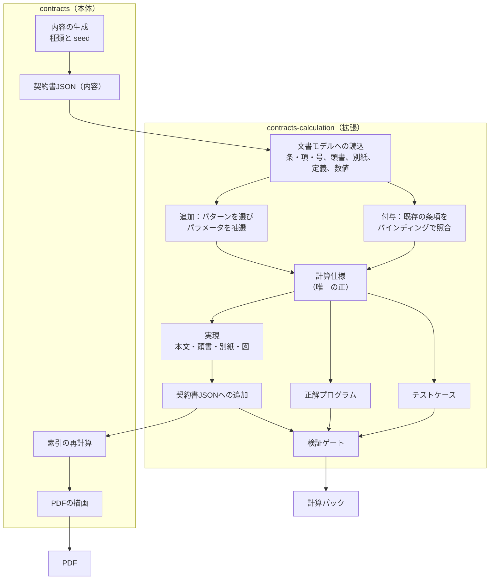

# contracts-calculation 設計書

契約書合成データ生成 `contracts` の拡張機能。既定の契約書JSONに対して、計算や判定を要する条項（本文・頭書・別紙の表・図）を追加または紐づけし、その正解プログラム（Python）とユニットテスト用の評価データを同時に生成する。

- 版: 0.1（設計）
- 日付: 2026-10-03
- 配置: `contracts/contracts-calculation/`

---

## 1. 要約

**計算仕様（CalcSpec）を唯一の正とし、そこから契約書の文言・正解プログラム・テストを同時に作る。** 文言と式を別々に作らないので、三者は構成上ずれない。機械検査で一致を確かめてから出力する。

```
計算仕様 ──┬─▶ 契約書JSONへの追加（条・項・号、頭書の行、別紙の表、図）──▶ 本体で索引の再計算・PDF化
（唯一の正） ├─▶ 正解プログラム（Python）
           ├─▶ テストケース（入力と期待値）＋ pytest
           └─▶ 正解表（どの単位がどのルールの根拠か）
```

契約書に固有の事情を、設計の中心に置いた。

| 契約書の事情 | 設計での扱い |
|---|---|
| 計算の多くが日付と期間に関わる（締日、支払期日、営業日、更新、通知期限） | 日付型と暦の関数を仕様の基本要素にする（§10） |
| 数値が本文・頭書・別紙・個別契約に分かれる | 数値の置き場所を表現の選択肢にし、契約書の外にある値は入力にする（§9.2） |
| 既定の契約書に、支払や遅延損害金などの計算条項が既にある | 新しい条項を足す「追加」と、既存の条項に仕様を紐づける「付与」の2モードを持つ（§6） |
| 書かれていないと読みが割れる事項が多い（日割の分母、段階料金の方式、初日の数え方） | 明示性の要件として列挙し、検証する（§9.4） |
| 金銭に向きがある（どちらがどちらに支払うか） | 仕様に当事者を持たせる（§9.7） |

この文書は設計を示す。本体 `contracts` の契約書JSONとコードは **2026-10-03 の M0 調査で実物照合済み**（`docs/m0_survey.md`）。前提（§3.1）は照合結果で書き直し、確認事項（§17）には結論を記入した。暦の関数と設例の数値は、付録A・Bのとおり実行して検算した。

---

## 2. 目的と範囲

### 2.1 目的

1. **読取評価の強化。** 計算や判定を含む条項、料金表、判定の流れ図を契約書に増やす。
2. **計算発見・コード生成の評価。** 「契約書から計算式・判定式が必要な条項を見つけ、実装し、テストする」システム（以下、評価対象システム）を採点するための正解データを作る。

### 2.2 作るもの

| 生成物 | 内容 | 利用者 |
|---|---|---|
| 追加後の契約書JSON | 既定の契約書JSONに計算・判定の条項を足したもの | 本体（PDF化）、読取評価、評価対象システム |
| 計算仕様 | 式、入力、定数、表、暦、根拠の対応 | 生成器自身、分析 |
| 正解プログラム | 仕様から生成した Python 関数 | 評価の基準 |
| 評価データ | テストケース（JSONL）と pytest | 評価対象システムの採点 |
| タスクカード | 関数名と入出力の契約 | 評価対象システムへの出題 |
| 正解表 | ルールと根拠単位の対応、表現手段、難易度 | 「発見」の採点、弱点の分析 |

### 2.3 範囲外

- 評価対象システム自体。
- PDFの描画と索引の計算。本体の機能を呼ぶ。
- 法令そのものの実装。税率、法定利率、祝日は、契約書に書かれた値か、外部からの入力として扱う。

---

## 3. 前提と用語

### 3.1 本体（`contracts`）についての前提（2026-10-03 実物照合済み）

照合の詳細は `docs/m0_survey.md`。

1. **本体は seed から契約書を量産しない。** 工程は `scaffold`（骨組み）→ Claude の執筆 → `build` であり、既定の契約書は `content/` の **20 件（10 doctype × 2）が全量**である。したがって本拡張の入力は常に既存 content（`--base`）であり、§15 の「種類と seed から新しい base を作る」形は存在しない。
2. 契約書JSONは、内容（meta、前文、定義、本文、別紙、後文・署名欄）と、`keiyaku build` が付与する索引 `derived`（labels / refs / term_uses / party_uses / plain_text / tables / figures / formulas / enumerations / toc）からなる。
3. 本文は条・項・号の木構造で、ノード（`a1`、`a1_p2`、`a4_p3_i1`）・表セル（`tbl_x__r0c1`）が安定したIDを持つ。紙面表記は `derived.labels[id].citation`（「第1条 2」）。
4. 表（`grid`＋`records` の二重表現、semantic_type 2 層語彙）と図 **6 種**（flowchart / tree / steps / timeline / annotated_mock / matrix、正規化グラフつき）と算式ブロックを持てる。頭書（`head_matter`）・別紙（`appendix`、`kind_label` 採番）もある。
5. 数値は **dictionary 型**：`meta.constants`（値は「10日」「300万円」「翌月末日」のような**日本語表記の文字列**）＋本文の `{const:key}`。数値整合は本体の lint L11 が検査する。本拡張の数値の往復（G4）は `numbers_ja` の表記⇄値の往復で実装する。
6. 当事者は `meta.parties`（key / alias / name）＋ `{party:key|name|full|role}`、定義語は `defined_terms`＋`{term:id}`。呼称の直書きは本体の lint L19 が error にする。
7. 索引の再計算とPDFの描画は、本体リポジトリのルートで `uv run keiyaku build <content_dir>` / `uv run keiyaku render <content_dir> --style <sid> --out <root>` として外から呼べる。**content_dir も出力先も任意パスを受ける**ため、「コピー → パッチ → build → render」の2段階実行が成立する。

### 3.2 用語

| 用語 | 意味 |
|---|---|
| 本体 | `contracts`。契約書JSONとPDFを生成する既存プログラム |
| 計算仕様（CalcSpec） | 1文書の計算・判定ルールの定義。式、入力、定数、表、暦、根拠を持つ |
| パターン | ルールの型（例：遅延損害金）。乱数からルール1件分の仕様を作る |
| 実現 | 仕様を契約書の文言・表・図に展開すること |
| バインディング | 既定の契約書に既にある条項と、仕様のひな形の対応づけ |
| 単位 | 契約書JSONの中で根拠として指せる最小のテキスト（項、号、表のセル、図のノードなど） |
| 頭書 | 契約の主要条件（期間、対価、支払条件など）をまとめた表 |
| 計算パック | 1文書分の生成物一式（仕様、正解プログラム、テスト、正解表、マニフェスト） |
| 評価対象システム | 契約書から計算式・判定式を発見し、コードを生成するシステム |

---

## 4. 設計方針

1. **仕様が唯一の正。** 契約書の文言、正解プログラム、テストの期待値は、同じ計算仕様から導く。人やLLMが文言とプログラムを別々に書く経路を作らない。
2. **本体のスキーマと能力の範囲で足す。** 本体が描画できるノードとブロックだけを使う。使える表現手段は、本体の能力の宣言から決める。
3. **決定的に生成する。** 同じ契約書、同じ seed、同じ生成器の版からは、同じバイト列を出力する。
4. **手がかりを漏らさない。** 追加したノードのIDや定数名に、拡張由来と分かる目印を付けない。正解は契約書JSONに入れず、別ファイルに置く。
5. **一義に読めるように書く。** 日数の数え方、日割の分母、端数処理、段階料金の方式などを、必ず文言にする（§9.4）。あえて欠落や矛盾を入れる場合は、ラベルを付けて別モードにする（§11.3）。
6. **検証してから出力する。** 検証ゲート（§14）をすべて通った文書だけを書き出す。
7. **生成の経路でLLMを呼ばない。** 実行時は標準ライブラリだけを使う。
8. **自己完結させる。** このプロジェクトは `contracts` リポジトリの中で完結させる。リポジトリの外にあるコード、データ、文書を参照しない。計算仕様の検証器、参照インタプリタ、コード生成、テスト生成は、すべてこのプロジェクトの中に実装する。
9. **本体への依存は1箇所。** 本体を呼ぶのは `base_adapter` だけにする。

### 4.1 採用しなかった方式

| 方式 | 採用しない理由 |
|---|---|
| 文言を先に書き、プログラムを後から人が書く | 一致の保証がなく、量産できない |
| LLMに文言とプログラムを同時に書かせる | 多様だが、正しさを保証できない。全件の人手確認が要る |
| 仕様から決定的に生成する（採用） | 文言の自然さと多様性に限界がある。文型の変種、数値の置き場所、図表化で補う（§9） |

---

## 5. 全体像



処理の順序は次のとおり。

1. 本体が契約書JSON（内容）を作る。
2. 拡張が契約書JSONを文書モデルに読み込む。単位、参照、定義語、数値、当事者を索引にする。
3. 追加モードでは、文脈に合うパターンを選び、seed からパラメータを抽選して仕様を作る。付与モードでは、既存の条項をバインディングで照合して仕様を作る。
4. 追加モードの仕様を実現する。条・項・号、頭書の行、別紙の表、図を本体のスキーマで組み立て、追加操作（パッチ）として記録する。
5. パッチを契約書JSONに適用し、本体で索引を再計算する。
6. 仕様から正解プログラムとテストケースを生成する。
7. 検証ゲートを通す。通らない文書は出力しない。
8. 本体でPDFを描画し、計算パックを書き出す。

---

## 6. 2つのモード：追加と付与

| | 追加 | 付与 |
|---|---|---|
| 対象 | 仕様から新しく作った条項 | 既定の契約書に既にある条項 |
| 契約書JSONの変更 | あり（条、別紙、頭書の行を足す） | なし |
| 文言と仕様の一致 | 構成上保証される | バインディングごとに検証で確かめる |
| 本体に必要なもの | 索引の再計算、PDFの描画 | 条項のテンプレートの識別子、または安定した文型。数値の出どころ |
| 一義に読めるか | 生成器が保証する | 本体の文言しだい。欠けていれば除外するか、ラベルを付ける |
| 多様性 | パターンと表現手段で制御する | 本体のテンプレートの範囲 |

### 6.1 付与モードのバインディング

バインディングは、本体の条項テンプレート1つにつき1つ、人が書く。

```yaml
id: late_interest.simple
genres: [outsourcing, sales]
match:
  template_id: clause.late_payment        # 本体が条項のテンプレートIDを出力に残している場合
  heading: 遅延損害金                      # 残していない場合は、見出しと文型で照合する
  text_patterns: ["年{rate}の割合", "遅延損害金"]
slots:
  rate: {from: constant, key: late_interest_rate}
  year_days: {from: text, pattern: "年{n}日の日割計算"}
spec: K17                                 # 仕様のひな形（§8）
obligations: [day_count, year_basis, rounding]
on_missing: exclude                       # exclude（評価から外す）／ trap（ラベルを付けて含める）
```

付与では、文言が仕様より先にある。そのため次を必ず行う。

- 引用の逐語照合と数値の往復（§14 の G2、G4）を、照合できた文書の全件で行う。
- 明示すべき事項（`obligations`）が文言にあるかを調べる。なければ `on_missing` に従う。
- バインディングごとに、人が1度レビューし、固定のテストを置く。本体のテンプレートが変わったら、照合が外れて検出できる。

### 6.2 進める順序

追加モードを先に作る。本体の文言に依存せず、正しさを構成上保証でき、生成から検証までの全工程を通せるためである。付与モードは、その後に、既定の契約書で出現の多い条項（支払、遅延損害金、契約期間と更新、損害賠償の上限）から順にバインディングを書く。

1つの文書に両方のルールが混ざってよい。正解表に `origin`（`added` または `bound`）を記録する。

---

## 7. ディレクトリ構成

実装の実体に合わせた構成（2026-10-05 照合）。設計当初に分けていた `placement.py` `presentation.py`
`discourse.py` `lexicon_ja.py` `discoverability.py` `layout.py` は、実装では責務の置き場所を次のように
寄せた。機能は欠けていない。

| 当初の分割 | 実装での置き場所 |
|---|---|
| `planning/placement.py`（置き場所の決定） | 各パターンが `value_location` を宣言し、`generate.py` が重みで選ぶ |
| `planning/presentation.py`（表現手段の割当） | `config.py` のプロファイル＋`generate.py` |
| `realize/discourse.py` `realize/lexicon_ja.py`（文型） | `patterns/base.py`（文型の変種）と各パターン |
| `verify/discoverability.py`（G11） | `verify/gates.py` に内包 |
| `verify/solvability.py`（G13） | 未実装（2026-10-04 見送り決定。`eval` CLI でそのまま測れる） |
| `export/layout.py`（配置・マニフェスト・ハッシュ） | `generate.py`＋`export/datasheet.py` |

```
contracts/
└── contracts-calculation/
    ├── README.md
    ├── CLAUDE.md                        # 憲章（守ること・現状・コマンド）
    ├── DESIGN.md                        # 本書
    ├── TASK.md  HITL.md  PROMPT.md
    ├── pyproject.toml  uv.lock
    ├── src/contracts_calculation/
    │   ├── cli.py                       # contracts-calc generate / bind / verify / eval / datasheet / datacard / lint-base
    │   ├── config.py                    # 生成設定（プロファイル basic/standard/hard/challenge、難易度、件数）
    │   ├── base_adapter.py              # 本体を呼ぶ唯一の場所（内容の取得、索引、PDF、スキーマ検証、能力の宣言）
    │   ├── generate.py                  # 追加モードの生成パイプライン（§5）
    │   ├── fictionalize.py              # 既知の実在名称との衝突を合成名称へ置換（コピー後の作業領域だけ）
    │   ├── docmodel/
    │   │   ├── index.py                 # 契約書JSON → 文書モデル（単位、参照、定義語、数値、当事者）
    │   │   └── numbers_ja.py            # 数値と日付の表記と読取（金1,000,000円、年14.6%、10営業日）
    │   ├── spec/
    │   │   ├── model.py                 # 計算仕様のデータ型
    │   │   ├── schema/calc_spec.schema.json
    │   │   ├── validate.py              # 型・単位・根拠・明示性の検査
    │   │   ├── interp.py                # 参照インタプリタ（意味論の正本）
    │   │   └── calendar.py              # 暦の関数（付録A）
    │   ├── patterns/                    # パターンライブラリ（§8）
    │   │   ├── base.py                  # パターンの定義とドラフト、文型の変種
    │   │   ├── registry.py              # 登録・MUTEX・REQUIRES
    │   │   ├── _tiered_common.py        # 段階料金（K03・K04）の共通部
    │   │   └── k01_unit_price.py … k31_precedence.py
    │   ├── bindings/                    # 付与モードのバインディング（§6.1）
    │   │   ├── engine.py                # 既定の条項への紐づけと除外の判定
    │   │   └── raw.py                   # 条項の実態の抽出（lint-base の材料）
    │   ├── planning/
    │   │   ├── context.py               # 契約書の種類、条の構成、定義語、当事者、既存の数値
    │   │   └── selector.py              # パターンの選択と衝突回避
    │   ├── realize/
    │   │   ├── blocks.py                # 本体スキーマのノード・ブロックの組立
    │   │   ├── figures.py               # 流れ図、時間軸
    │   │   └── patch.py                 # 追加操作の適用、ID・定数・定義語の払出し
    │   ├── codegen/python.py            # 正解プログラムの生成
    │   ├── testgen/
    │   │   ├── cases.py                 # 境界値・日付の境界・不明値・乱数・設例
    │   │   ├── mutation.py              # テストの十分性の測定
    │   │   ├── taskcards.py             # 入出力の契約
    │   │   └── pytest_writer.py
    │   ├── verify/gates.py              # 検証ゲート G1〜G12（§14）
    │   ├── evalkit/
    │   │   ├── runner.py                # 提出プログラムの隔離実行
    │   │   ├── discovery.py             # 「発見」の採点
    │   │   └── report.py
    │   ├── export/
    │   │   ├── datasheet.py             # データセットの説明書（README）
    │   │   └── datacard.py              # データカード（data-card.md）
    │   └── h5/                          # 親 HITL_TODO H5（apply 47 問）の検算：specs.py・verify.py
    ├── packs/
    │   ├── values.json                  # パターンごとのパラメータ候補（きりのよい値）
    │   ├── concepts.json                # 入力概念の語彙（名前、日本語名、型、単位、出どころ）
    │   ├── fictional_names.json         # 実在名称 → 合成名称の対応
    │   └── calendar/holidays_jp.json    # 祝日の一覧（固定版。scripts/make_calendar.py で生成）
    │   # 2026-10-03: YAML から JSON に変更（実行時は標準ライブラリだけ、の規則と両立させるため）
    ├── scripts/                         # make_calendar.py・update_examples.py・verify_data_card.py
    ├── docs/                            # 調査・レビュー・決定の記録（索引は docs/README.md）
    ├── tests/                           # 生成器自身のテスト
    └── examples/                        # 生成例（回帰テストの基準。コミットする）
```

生成物 `data/`・`data_bind/`・`dataset/` はコミットしない（`.gitignore`）。決定的に再生成できる。

---

## 8. 計算・判定の型（パターンライブラリ）

パターンは、ルールの型である。1つのパターンが、同じ乱数から「契約書に足す内容」と「仕様」の両方を作る。

### 8.1 カタログ

優先度Aから実装する。設例は付録Bにまとめた。

**A. 対価の計算**

| ID | 型 | 式の形 | 優先度 |
|---|---|---|---|
| K01 | 単価×数量（下限・上限つき） | `単価 × 数量` を最低料金と上限額の間に収める | A |
| K02 | 固定＋従量 | `基本料金 + max(0, 利用量 − 無償枠) × 従量単価` | A |
| K03 | 段階料金（全量方式） | 数量が属する段階の単価を、全量に掛ける | A |
| K04 | 段階料金（超過分方式） | 段階ごとの超過分に、それぞれの単価を掛けて合計する | A |
| K05 | 精算幅つき月額 | 稼働時間が下限未満なら控除、上限超過なら加算し、0円を下限とする | A |
| K06 | 料率×基準額 | `売上 × 料率`。最低保証額と上限額つき | B |
| K07 | 日割 | `月額 × 利用日数 ÷ 分母` | A |
| K08 | 消費税の加算 | `税抜額 × 税率`。端数処理つき | A |
| K09 | 割戻し | 年間取引額に応じた割戻率の表 | B |
| K10 | 価格改定 | 個別契約に定める指数の変動率に連動。改定幅の上限つき | C |

**B. 期日と期間**

| ID | 型 | 式の形 | 優先度 |
|---|---|---|---|
| K11 | 締日と支払期日 | 締日の翌月（翌々月）の指定日。休業日は前営業日または翌営業日 | A |
| K12 | 期間の満了日 | 開始日から N か月・N 年。初日を数えるかどうか | A |
| K13 | 更新と通知期限 | 満了日の N か月前までに通知がなければ更新 | A |
| K14 | 検査期限とみなし合格 | 納入日から N 営業日以内。通知がなければ合格とみなす | A |
| K15 | 保証期間と請求期限 | 検収日から N か月以内に通知 | B |
| K16 | 存続期間 | 契約終了日から N 年 | C |

**C. 遅延・違反・責任**

| ID | 型 | 式の形 | 優先度 |
|---|---|---|---|
| K17 | 遅延損害金 | `未払額 × 年率 × 遅延日数 ÷ 365` | A |
| K18 | 納期遅延の違約金 | `契約金額 × 日率 × 遅延日数`。上限つき | A |
| K19 | 中途解約金 | `残存月数 × 月額 × 率` | B |
| K20 | 損害賠償の上限と除外 | `min(損害額, 直近 N か月の対価)`。故意・重過失は上限なし | A |
| K21 | 補償の下限・バスケット・上限 | 個別の下限、累計のしきい値、総額の上限 | B |
| K22 | サービスレベルの返金 | 稼働率の段階に応じた返金率 | B |

**D. 判定**

| ID | 型 | 式の形 | 優先度 |
|---|---|---|---|
| K23 | 解除権の発生 | 無催告の事由のいずれか、または違反＋催告＋期間経過＋未是正 | A |
| K24 | 期限の利益の喪失 | 当然に失う事由と、請求により失う事由 | B |
| K25 | 秘密情報の該当性 | 定義に当たり、除外事由のいずれにも当たらない | A |
| K26 | 不可抗力による免責 | 事由に当たり、事由の発生日以後かつ期限内に通知した | B |
| K27 | 最低購入義務の達成 | 実績が最低数量以上か。未達時の補填額 | B |
| K28 | 手続の流れ | 図だけに書かれた判定の連鎖（検査、変更管理） | B |

**E. 合成と優先**

| ID | 型 | 式の形 | 優先度 |
|---|---|---|---|
| K29 | 請求額の合成 | 小計 → 値引き → 税 → 合計 | B |
| K30 | 精算 | `預り金 − 未払金 − 原状回復費用`。0円を下限とする | C |
| K31 | 優先順位による解決 | 本文・別紙・個別契約の定めが異なるとき、どれが適用されるか | B |

### 8.2 型ごとの注意

- **K03 と K04 は、同じ料金表から違う金額になる。** 250件なら全量方式は100,000円、超過分方式は110,000円である（付録B）。どちらの方式かを必ず文言にする。
- **K03 は、境界で金額が下がることがある。** 100件が50,000円、101件が40,400円になる。単調性を性質として宣言しない。
- **K20 の「直近 N か月」は、基準日を決めないと計算できない。** 「損害の原因となった事由が生じた日の前日までの12か月間」のように書く。
- **K21 のバスケットは、超えたときに全額か超過額だけかで結果が変わる。** 対象の損害の合計が130万円、しきい値が100万円なら、全額方式は130万円、超過額方式は30万円である。
- **K22 の稼働率は、割り算をせずに比較する。** `稼働時間 × 1000 ≥ 999 × 対象時間` のように、整数の掛け算で段階を判定する。計画停止を分母と分子の両方から除くかどうかも文言にする。
- **K13 と K14 の「通知がない」は、真偽の入力で表す。** `None` は「不明」だけを意味する（§12.3）。

### 8.3 パターンのインターフェース

```python
class Pattern(Protocol):
    id: str                                   # "K17"
    genres: set[str]                          # 適用できる契約書の種類

    def applicable(self, ctx: Context) -> bool:
        """既定の契約書に必要な条・定義語・当事者があり、既存の条項と衝突しないか。"""

    def sample(self, ctx: Context, rng: Random) -> RuleDraft:
        """パラメータを抽選し、仕様の下書き（式、入力、定数、明示すべき事項）を返す。"""
```

`RuleDraft` は表現に依存しない。文言と図表への展開は実現（§9）が受け持つ。

### 8.4 文脈と衝突回避

`Context` は、既定の契約書から次を読み取る。

- 契約書の種類、条の一覧と見出し
- 当事者の呼称と役割（委託者と受託者、売主と買主、貸主と借主）
- 定義語と、既存の数値（本文、頭書、別紙）
- 既存の計算条項（言い回しと構造による検出、またはバインディングの照合結果）

衝突回避の規則は次のとおり。

- 既定の契約書に同じ事項の条項があるパターンは、追加しない。支払期日の条項が既にあれば、K11 は追加せず、付与の対象にする。
- 定数名、定義語、別紙の番号は、既定の契約書にないものを使う。衝突したら生成を止める。
- 既存の数値を使うときは参照する。同じ事項に2つ目の数値を書かない。

### 8.5 パラメータの抽選

- 値の範囲は `packs/<種類>.yaml` に持つ。きりのよい値（10営業日、年14.6%、3か月前）から選ぶ。
- 制約を守る。例：精算幅の下限 < 上限、段階の境界は昇順、通知期限 < 契約期間。
- 入力概念は `packs/concepts.yaml` の語彙から選ぶ。同じ概念には、文書をまたいで同じ引数名を使う。
- 乱数列は、文書ごと・ルールごとに独立させる。パターンを足しても、既存の文書の出力が変わらないようにする。

---

## 9. 実現：仕様を契約書に展開する

### 9.1 手順の計画

式の木を、名前つきの手順に分ける。1つの手順が、1つの文、表の1行、図の1ノードのどれかになる。正解プログラムも同じ手順を変数にする。文と変数が1対1に対応する。

```
max(0, 支払日 − 支払期日)            → 手順1「遅延日数」（文「支払期日の翌日から支払日まで」）
未払額 × 手順1 × 年率 ÷ 365           → 手順2「遅延損害金」（文「年14.6%の割合（年365日の日割計算）」）
```

### 9.2 数値の置き場所

契約書では、数値が本文だけにあるとは限らない。同じルールの数値を、次のどこに置くかを seed から決める。

| 置き場所 | 書き方の例 | 仕様での扱い |
|---|---|---|
| 本文 | 「年14.6%の割合による」 | 定数 |
| 頭書 | 本文は「頭書記載の委託料」と書き、頭書の表に金額を置く | 定数。根拠は頭書のセル |
| 別紙 | 本文は「別紙1に定める単価」と書き、別紙の料金表に置く | 定数または参照表。根拠は別紙のセル |
| 個別契約・注文書 | 本文は「個別契約に定める納期」と書く | 入力（出どころ `order`）。契約書には値がない |

数値は1箇所にだけ書く。本文と頭書の両方に同じ金額を書かない。

### 9.3 演算と文型

文体は、既定の契約書に合わせる。次は「…ものとする。」の文体での例である。

| 演算 | 文型の例 |
|---|---|
| 乗算 | 「…に…を乗じた額とする。」 |
| 加算、差引 | 「…に…を加算した額」「…から…を控除した額」 |
| 上限 | 「ただし、…を上限とする。」「…を超えないものとする。」 |
| 下限 | 「…に満たない場合は、…とする。」 |
| 年率の日割 | 「年14.6%の割合（年365日の日割計算）による」 |
| 日割 | 「1か月に満たない期間は、当該月の日数による日割計算とする。」 |
| 端数処理 | 「1円未満の端数は切り捨てる。」 |
| 段階料金 | 「次表の区分に応じた単価を、当月の全数量に適用する。」／「各区分に属する数量に、当該区分の単価を乗じて合計する。」 |
| 期限 | 「…の翌日から起算して10営業日以内に」 |
| 期日の調整 | 「当該日が金融機関の休業日に当たる場合は、その前営業日とする。」 |
| みなし | 「…までに通知がない場合は、合格したものとみなす。」 |
| 更新 | 「期間満了日の3か月前までに書面による通知が相手方に到達しない限り、同一の条件で1年間更新する。」 |
| いずれか、すべて | 「次の各号のいずれかに該当したとき」「次の各号のすべてを満たす場合に限り」 |
| 除外 | 「ただし、次の各号のいずれかに該当するものは、この限りでない。」 |
| 既定値 | 「個別契約に定めのない場合は、…とする。」 |
| 優先 | 「本契約と個別契約の定めが異なる場合は、個別契約の定めが優先する。」 |

各演算に2〜4個の文型の変種を持つ。変種はすべて同じ意味で、1つずつ単体テストを持つ。

### 9.4 明示性の要件

通常モードでは、次を必ず文言にする。書かれていないと、契約書だけからは結果が決まらない。パターンが「明示すべき事項」を宣言し、検証ゲートG3が、対応する文が出力されたかを確かめる。

| 構造 | 必ず書くこと |
|---|---|
| 日数で定めた期間 | 起算日（当日か翌日か）と、末日を含むか |
| 月・年で定めた期間 | 開始日を含めて数えるか。応当する日がない月の扱い |
| 営業日 | 営業日の定義（土日、祝日、年末年始） |
| 期日が休業日に当たるとき | 前営業日か翌営業日か |
| 遅延日数 | 支払期日の翌日から数えるか。支払った日を含むか |
| 年率 | 1年を何日とするか。うるう年の扱い |
| 日割 | 分母（当月の日数、30日、365日のどれか） |
| 端数処理 | 単位と方向。明細ごとか合計に対してか |
| 税 | 金額が税抜か税込か。税率の出どころ。税額の端数処理 |
| 段階料金 | 全量方式か超過分方式か。境界の数量がどちらの段階か |
| 上限・下限 | 適用順（控除の前か後か、税の前か後か） |
| 対象期間のある上限 | 基準日と期間（事由が生じた日の前日までの12か月間、など） |
| バスケット | 超えたときに全額か、超過額だけか |
| みなし規定 | いつまでに何がなければ、何が成立するか |
| 通知 | 到達した日で判定するか、発信した日か。方法（書面） |
| 当事者 | どちらがどちらに支払うか |
| 既定値 | 個別契約に定めがないときの値 |
| 違約金 | 違約金を超える損害を請求できるか |

### 9.5 表現手段

本体が描画できるものだけを使う。`base_adapter` が能力を宣言し、実現はその範囲で選ぶ。

```python
@dataclass(frozen=True)
class BaseCapabilities:
    node_kinds: frozenset[str]        # 条、項、号、別紙 など
    table: bool                       # 表を持てるか
    header_sheet: bool                # 頭書があるか
    figure_kinds: frozenset[str]      # 流れ図、時間軸 など。空なら図を使わない
    formula: bool                     # 算式ブロックがあるか
    constants: str                    # "dictionary"（定数の一覧と参照記法）または "inline"（本文に直接書く）
    style: str                        # 文体
```

| 表現手段 | 向くもの | 本体に必要な能力 |
|---|---|---|
| 本文（条・項・号） | すべて | なし |
| 号の列挙 | 解除事由、除外事由 | 号 |
| 頭書の行 | 期間、対価、支払条件 | 頭書 |
| 別紙の表 | 料金表、段階表、返金率の表 | 表、別紙 |
| 算式 | 加減乗除の1行 | 算式ブロック |
| 流れ図 | 検査の手続、解除の手続 | 図（流れ図） |
| 時間軸 | 契約期間、更新、通知期限 | 図（時間軸） |
| 別紙の計算例 | 設例。説明であり、規範ではない | 別紙 |

図と本文の役割は3通りある。図だけが規範、本文が規範で図は説明、本文と図で分担、である。図の代替テキストは、図の構造から機械的に作る。

### 9.6 配置

| 配置 | 内容 | 難しさ |
|---|---|---|
| 条の追加 | 関連する条の後に、条を足す | 低 |
| 項・号の追加 | 追加した条の中で、ただし書や号に分ける | 低 |
| 頭書・別紙への分離 | 数値や表を頭書・別紙に置き、本文から参照する | 中 |
| 分散 | 1つのルールの手順を、別の条、定義条項、別紙に分ける | 高 |
| 優先順位つき | 本文と別紙に違う定めを置き、優先順位の条項で決まるようにする（K31） | 高 |

既存の文言は書き換えない。足すだけにする。条を途中に足すと後続の条番号がずれるので、索引は本体で再計算する。

### 9.7 当事者

仕様は、金銭の向きを当事者の役割で持つ（支払う側と受け取る側）。文言では、本体の呼称（甲・乙など）に置き換える。関数の戻り値は金額だけにし、向きはタスクカードと関数の説明に書く。

### 9.8 言い換え

第1版は文型テンプレートだけを使う。LLMによる言い換えを足す場合は、次をすべて通ったものだけを採用する。

1. 数値、定数の参照、定義語、当事者が、言い換えの前後で一致する。
2. 言い換えた文から、基準となるシステムが実装したプログラムが、同じテストに合格する。
3. 抜き取りで人が確認する。

---

## 10. 暦と期間

契約書の計算の多くは日付に関わる。日付型と暦の関数を、仕様の基本要素にする。参照実装は付録Aにある。

### 10.1 営業日と祝日

- 営業日の定義は、契約書に書く。例：「営業日とは、土曜日、日曜日、国民の祝日及び12月29日から翌年1月3日までの日を除いた日をいう。」
- 土日と年末年始は、契約書の定義から決まる。仕様の `calendar` に持つ。
- 祝日は契約書の外の事実である。関数の入力 `holidays` として渡す。データセットに祝日の一覧（`calendar.json`）を付け、公開する。
- 評価対象システムは、祝日を知っている必要がない。暦を使う関数は、タスクカードに `uses_calendar: true` と書き、テストの実行時に `holidays` を渡す。

### 10.2 文言と式の対応

| 文言 | 式 | 例（付録Bで検算） |
|---|---|---|
| 「Xの日から起算して N 日以内」 | `add_days(X, N − 1)` | |
| 「Xの翌日から起算して N 日以内」 | `add_days(X, N)` | |
| 「Xの翌日から起算して N 営業日以内」 | `add_business_days(X, N)` | 納入 2026-12-22 → 2027-01-11 |
| 「Xから N 年間（Xを含む）」 | `period_end(X, N, "year", True)` | 2026-10-01 から1年 → 2027-09-30 |
| 「Xから N 年間（Xを含まない）」 | `period_end(X, N, "year", False)` | 2026-10-01 から1年 → 2027-10-01 |
| 「満了日の N か月前まで」 | `add_months(E, −N)` | 2027-09-30 → 2027-06-30 |
| 「毎月末日締め、翌月末日払い」 | `end_of_month(add_months(締日, 1))` | 2026-09-30 → 2026-10-31 |
| 「休業日に当たる場合は前営業日」 | `prev_business_day(D)` | 2026-10-31（土）→ 2026-10-30 |
| 「休業日に当たる場合は翌営業日」 | `next_business_day(D)` | 2026-10-31（土）→ 2026-11-02 |
| 「支払期日の翌日から支払日まで」の日数 | `max(0, days_between(期日, 支払日))` | 2026-11-30 → 2026-12-25 は25日 |

### 10.3 落とし穴

テスト生成は、次の日付を必ず含める（§13.4）。

- **応当する日がない月。** 1月31日から1か月の期間は、2月末日に満了する。8月31日の3か月前は5月31日、5月31日の3か月前は2月28日である。
- **うるう年。** 2月29日を含む期間、年365日固定の日割。
- **年末年始。** 営業日の数え方が、祝日の有無で1日ずれる（付録Bの検査期限の例）。
- **月末が休業日。** 前営業日にすると月内、翌営業日にすると翌月になる。

---

## 11. 難易度と多様性

### 11.1 難易度の軸

| 軸 | 値 | 例 |
|---|---|---|
| 表現手段 | 本文のみ、別紙の表、図のみ | 図だけに書かれた検査の手続 |
| 数値の置き場所 | 本文、頭書、別紙、個別契約 | 単価が別紙、納期が個別契約 |
| 分散度 | 根拠単位の数と距離 | 営業日の定義が定義条項にある |
| 合成の深さ | 手順の数、他のルールへの依存 | 支払期日 → 遅延日数 → 遅延損害金 |
| 暦 | なし、日数、営業日、月・年、月末の調整 | 年末年始をまたぐ検査期限 |
| 条件の構造 | 単純、号の列挙、原則と除外、除外の例外 | 秘密情報の除外事由 |
| 優先 | なし、既定値、優先順位の条項 | 個別契約が本文に優先する |
| 妨害要素 | 計算例の数値、似た名称の別の金額 | 規範でない数値が近くにある |
| 不明値 | 三値の判定が要るか | 通知の到達日が不明 |

各ルールの難易度は、正解表にベクトルとして記録する。評価結果を軸ごとに集計できる。

### 11.2 プロファイル

設定ファイルで、軸ごとの出現割合を指定する。割合の具体値は運用で決める。

| プロファイル | ねらい |
|---|---|
| `basic` | 1つの条に閉じたルール。数値は本文にある |
| `standard` | 頭書や別紙への分離、営業日と月の計算、判定と金額の連鎖 |
| `hard` | 分散、優先順位、図のみ、年末年始や月末をまたぐ暦 |

### 11.3 ラベル付きの難所（challenge モード）

通常モードは一義に読める文書だけを作る。challenge モードでは、あえて次を入れ、正解表にラベルを付ける。評価対象システムが「実装できない、確認が要る」と報告できるかを測る。

| 種別 | 入れ方 | 採点 |
|---|---|---|
| 欠落 | 明示性の要件を1つ外す（例：日割の分母を書かない） | 指摘の有無。テストは、欠落に影響されないケースだけを使う |
| 矛盾 | 本文と別紙で違う値を書き、優先順位の条項を置かない | 指摘の有無。両方の読みで結果が同じケースだけをテストに使う |
| 異例 | 上限が下限を下回る、通知期限が契約期間より長い、など | 指摘の有無 |

優先順位の条項がある食い違い（K31）は、矛盾ではない。一義に決まるので、通常モードの `hard` に含める。

---

## 12. データモデル

### 12.1 計算仕様（CalcSpec）

```json
{
  "spec_version": "0.1",
  "document": {"content_id": "outsourcing-0001", "genre": "outsourcing", "calc_seed": 1},
  "calendar": {
    "weekend": ["SAT", "SUN"],
    "closed": [["12-29", "01-03"]],
    "holidays": "input",
    "source": {"unit": "art2_i5", "quote": "土曜日、日曜日、国民の祝日及び12月29日から翌年1月3日までの日を除いた日"}
  },
  "params": {
    "late_rate": {"type": "ratio", "num": 146, "den": 1000, "surface": "年14.6%",
                  "source": {"unit": "art12_p1", "quote": "年14.6%の割合"}},
    "year_days": {"type": "int", "unit": "DAY", "value": 365, "surface": "年365日",
                  "source": {"unit": "art12_p1", "quote": "年365日の日割計算"}}
  },
  "tables": {},
  "rules": [{
    "id": "late_interest",
    "title": "遅延損害金の額",
    "kind": "calculation",
    "origin": "added",
    "parties": {"payer": "乙", "payee": "甲"},
    "interface": {"function": "late_interest"},
    "inputs": {
      "unpaid_amount": {"type": "int", "unit": "JPY", "min": 0, "max": 100000000,
                        "origin": "fact", "desc": "支払期日までに支払われなかった金額"},
      "due_date": {"type": "date", "min": "2026-01-01", "max": "2029-12-31", "origin": "fact", "desc": "支払期日"},
      "paid_date": {"type": "date", "min": "2026-01-01", "max": "2029-12-31", "origin": "fact", "desc": "実際に支払った日"}
    },
    "steps": [
      {"name": "late_days", "label": "遅延日数",
       "expr": {"op": "max", "args": [{"lit": 0},
                {"op": "days_between", "args": [{"var": "due_date"}, {"var": "paid_date"}]}]}},
      {"name": "late_interest", "label": "遅延損害金の額",
       "expr": {"op": "muldiv", "rounding": "floor", "args": [
                {"op": "mul", "args": [{"var": "unpaid_amount"}, {"step": "late_days"}]},
                {"param": "late_rate"}, {"param": "year_days"}]}}
    ],
    "output": {"step": "late_interest", "type": "int", "unit": "JPY"},
    "obligations": ["day_count:next_day_to_payment_day", "year_basis:365", "rounding:floor_1yen", "parties"],
    "presentation": {"pattern": "K17", "placement": "article", "value_location": {"late_rate": "body"}},
    "sources": [{"unit": "art12_p1", "quote": "支払期日の翌日から支払済みに至るまで"}],
    "properties": [{"type": "range", "min": 0}, {"type": "monotone", "input": "unpaid_amount", "dir": "+"}],
    "examples": [{"oracle": "manual",
                  "inputs": {"unpaid_amount": 1000000, "due_date": "2026-11-30", "paid_date": "2026-12-25"},
                  "expect": 10000}],
    "difficulty": {"calendar": "days", "value_location": "body", "scatter": 1, "depth": 2}
  }]
}
```

単位ID（`art12_p1` など）は例である。実際は本体の命名規則に従う。

### 12.2 型と演算

| 型 | 内容 | 例 |
|---|---|---|
| `int` | 整数。単位を必ず持つ | `JPY`、`DAY`、`MONTH`、`HOUR`、`MIN`、`COUNT`、`JPY/HOUR` |
| `ratio` | 分子と分母の整数の組 | 年14.6% は 146/1000 |
| `bool` | 真偽（三値） | |
| `enum` | 列挙値 | 通知の方法 |
| `date` | 日付。JSONでは `YYYY-MM-DD` | `2026-10-31` |
| 明細 | 項目の並び | 損害の一覧、月ごとの支払額 |

演算は次に限る。これ以外を仕様に書けないようにし、すべてを機械で検査できるようにする。

| 区分 | 演算 |
|---|---|
| 算術 | `add` `sub` `mul` `muldiv` `round_to` `min` `max` |
| 比較 | `lt` `le` `gt` `ge` `eq` `ne`（整数、日付、列挙値） |
| 論理 | `and` `or` `not` |
| 分岐 | `if` `case` `coalesce` |
| 表 | `lookup`（一致、階段）、`tiered`（全量方式、超過分方式） |
| 明細 | `agg`（合計、最大、最小、件数、いずれか、すべて） |
| 日付 | `add_days` `add_months` `end_of_month` `set_day`（日の指定。無い日は末日） `period_end` `days_between` `days_in_month` `is_business_day` `next_business_day` `prev_business_day` `add_business_days` |
| 参照 | `step`（同じルールの手順）、`rule`（他のルール） |

### 12.3 意味論

参照インタプリタ（`spec/interp.py`）を正本とする。

- **金額は整数の円。** 浮動小数点を使わない。
- **割り算は `muldiv(a, b, c, 丸め)` だけ。** `a × b ÷ c` を整数で返す。`b` と `c` は整数または割合で、割合は分子と分母に展開する。丸め（切捨て、切上げ、四捨五入）は必須である。
- **割合どうしの比較は、掛け算に直す。** `a ÷ b ≥ n ÷ d` は `a × d ≥ n × b` と書く。
- **不明は `None`。** 算術、比較、表引き、日付の演算は、引数に不明があれば不明を返す。
- **真偽は三値。** `and` は偽が1つでもあれば偽、`or` は真が1つでもあれば真。それ以外で不明があれば不明。
- **`if` は、条件が不明なら不明。**
- **`None` は「不明」だけを意味する。** 「通知がない」「定めがない」は、真偽の入力か、`optional` を宣言した入力と `coalesce` で表す。
- **ゼロ除算と、表にないキーは不明。** 検証器が、宣言した値域でこれが起きないことを確かめる。
- **日付の演算は付録Aの定義による。**

### 12.4 入力の出どころ

| 出どころ | 内容 | 例 |
|---|---|---|
| `order` | 個別契約、注文書、仕様書に定める値 | 単価、数量、納期、契約金額 |
| `fact` | 起きた事実 | 納入日、検収日、稼働時間、売上高、支払日、停止時間 |
| `notice` | 当事者の通知や意思表示の有無と日付 | 更新しない旨の通知の到達日、検査結果の通知日、催告日 |
| `judgment` | 評価を要する事項 | 故意・重過失、重大な違反、是正されたか |
| `external` | 法令、指標、暦 | 税率、祝日、物価指数 |

契約書（本文、頭書、別紙）に書かれた値は、入力ではなく定数である。

### 12.5 契約書JSONへの追加（パッチ）

追加は操作の列として記録する。

| 操作 | 内容 |
|---|---|
| `add_node` | 条、項、号、別紙を足す |
| `add_block` | 既存または追加したノードに、表・図・算式を足す |
| `add_header_row` | 頭書に行を足す |
| `add_constant` | 定数を足す（本体が定数の一覧を持つ場合） |
| `add_term` | 定義語を足す |

既存の文言を書き換える操作は持たない。パッチの適用後に、本体で索引を再計算する。付与モードはパッチを作らない。

### 12.6 出力の配置

```
<出力先>/<content_id>/
├── contract.json                    # 追加後の契約書JSON（索引は再計算済み）
├── <content_id>--<レイアウト>.pdf    # 本体が描画
└── calc/
    ├── spec.json                    # 計算仕様
    ├── patch.json                   # 追加操作の記録
    ├── answer_key.json              # 正解表
    ├── tasks.jsonl                  # タスクカード
    ├── cases.jsonl                  # テストケース
    ├── calendar.json                # 祝日の一覧（公開）
    ├── programs/calc_<id>.py        # 正解プログラム
    ├── tests/conftest.py
    ├── tests/test_calc_<id>.py
    └── manifest.json                # 版、seed、ハッシュ、検証結果
```

`contract.json` には、正解への参照や拡張の版を書かない。

| ファイル | 評価対象システムに渡すか |
|---|---|
| `contract.json`、PDF、`calendar.json` | 渡す |
| `tasks.jsonl` | 渡す（ヒントの水準は §13.5） |
| `cases.jsonl`、`tests/` | 渡さない。設例だけ公開してよい |
| `spec.json`、`programs/`、`answer_key.json`、`patch.json` | 渡さない |

### 12.7 正解表

```json
{
  "rule": "late_interest",
  "function": "late_interest",
  "pattern": "K17",
  "origin": "added",
  "units": ["art12_p1"],
  "explanatory_units": [],
  "definition_units": ["art2_i5"],
  "value_locations": {"late_rate": "body"},
  "modalities": ["prose"],
  "difficulty": {"calendar": "days", "scatter": 1, "depth": 2}
}
```

`units` は規範の根拠、`definition_units` は計算に要る定義（営業日の定義など）、`explanatory_units` は説明（計算例など）である。「発見」の採点は `units` と `definition_units` に対して行う。

---

## 13. 正解プログラムと評価データ

### 13.1 正解プログラムの規約

- 1文書につき1モジュール。標準ライブラリだけを使う。暦の関数はモジュールに含め、単独で動くようにする。
- 1ルールにつき1関数。引数はキーワード専用にする。手順の名前を変数名にする。
- 金額は整数の円。日付は `datetime.date`。
- 入力が `None`（不明）で結果を確定できないときは、`None` を返す。
- 定数は、根拠の条番号をコメントに付けてモジュールの先頭に置く。
- 関数の説明文字列に、根拠の条番号と、金銭の向きを書く。

目標とする書式は次のとおり。付録Bの設例で動作を確かめた。

```python
from datetime import date

P_LATE_RATE = (146, 1000)            # 年14.6%  根拠: 第12条第1項
P_YEAR_DAYS = 365                    # 年365日の日割計算  根拠: 第12条第1項
P_CLOSED = (((12, 29), (1, 3)),)     # 12月29日から翌年1月3日まで  根拠: 第2条第5号

# end_of_month、add_months、prev_business_day は、モジュールに含めた暦の関数（付録A）


def late_interest(*, unpaid_amount: int | None = None, due_date: date | None = None,
                  paid_date: date | None = None) -> int | None:
    """遅延損害金の額（第12条第1項）。乙が甲に支払う。"""
    if unpaid_amount is None or due_date is None or paid_date is None:
        return None
    late_days = max(0, (paid_date - due_date).days)                  # 支払期日の翌日から支払日まで
    num, den = P_LATE_RATE
    return unpaid_amount * late_days * num // (den * P_YEAR_DAYS)    # 1円未満切捨て


def payment_due_date(*, closing_date: date | None = None,
                     holidays: frozenset[date] = frozenset()) -> date | None:
    """支払期日（第8条第2項）。月末締め、翌月末日払い。休業日に当たる場合は前営業日。"""
    if closing_date is None:
        return None
    due = end_of_month(add_months(closing_date, 1))
    return prev_business_day(due, holidays, P_CLOSED)
```

### 13.2 タスクカード

評価対象システムのプログラムを同じテストで採点するには、関数名と引数を揃える必要がある。タスクカードで契約を渡す。

```json
{
  "task_id": "outsourcing-0001:late_interest",
  "function": "late_interest",
  "title": "遅延損害金の額",
  "kind": "calculation",
  "parties": {"payer": "乙", "payee": "甲"},
  "inputs": [
    {"name": "unpaid_amount", "type": "int", "unit": "JPY", "desc": "支払期日までに支払われなかった金額", "origin": "fact", "nullable": true},
    {"name": "due_date", "type": "date", "desc": "支払期日", "origin": "fact", "nullable": true},
    {"name": "paid_date", "type": "date", "desc": "実際に支払った日", "origin": "fact", "nullable": true}
  ],
  "output": {"type": "int", "unit": "JPY", "nullable": true},
  "uses_calendar": false,
  "conventions": {"call": "キーワード引数で呼び出す", "money": "金額は整数（円）", "date": "datetime.date",
                  "unknown": "入力が None で結果を確定できないときは None を返す"}
}
```

### 13.3 テストケース

```json
{"case_id": "outsourcing-0001:late_interest:b003", "function": "late_interest", "kind": "boundary",
 "inputs": {"unpaid_amount": 1000000, "due_date": "2026-11-30", "paid_date": "2026-11-30"}, "expected": 0}
{"case_id": "outsourcing-0001:late_interest:b004", "function": "late_interest", "kind": "boundary",
 "inputs": {"unpaid_amount": 1000000, "due_date": "2026-11-30", "paid_date": "2026-12-01"}, "expected": 400}
{"case_id": "outsourcing-0001:late_interest:u001", "function": "late_interest", "kind": "unknown",
 "inputs": {"unpaid_amount": 1000000, "due_date": "2026-11-30", "paid_date": null}, "expected": null}
```

日付は文字列で持ち、テストの実行時に `datetime.date` に直す。戻り値が日付のときも同じである。

| 種別 | 作り方 | ねらい |
|---|---|---|
| `example` | 契約書に書いた計算例、またはパターンが持つ設例 | 文書と仕様の一致。公開してよい |
| `boundary` | 定数と表キーの±1、入力どうしの±1、日付の境界 | 以上と超える、上限、段階の境目、期限の当日と翌日 |
| `unknown` | 入力を1つずつ `None` にする | 不明の伝播。採点から外せるよう種別を分ける |
| `random` | 宣言した値域からの乱数 | 全体の挙動 |

### 13.4 テストの作り方

1. **境界値を集める。** 入力と同じ単位を持つ定数と表キーについて、その値と±1を使う。同じ単位の入力どうしは、等しい場合と±1を使う。
2. **日付の境界を足す。** 期限の当日・前日・翌日、月末（28日・29日・30日・31日）、うるう年の2月29日、年末年始の休業の前後、土日の前後を使う。暦を使う関数には、祝日が空の場合と、境界の日が祝日の場合を使う。
3. **不明値を足す。** 入力を1つずつ `None` にする。
4. **変異で選ぶ。** 仕様を1箇所だけ壊した変異（比較の取り違え、`min` と `max` の入替、定数の±1、丸めの方向、日数の±1、前営業日と翌営業日の入替、全量方式と超過分方式の入替）を作る。すべての変異を検出できるケースの組を選ぶ。
5. **足りなければ探索する。** 境界値で検出できない変異が残ったら、乱数で検出できる入力を探して足す。見つからない変異は、等価である理由を記録する。
6. **期待値を計算する。** 参照インタプリタで計算する。正解プログラムの出力と一致しなければ、生成を止める。

### 13.5 pytest と採点

```
pytest calc/tests                        # 正解プログラムで実行
pytest calc/tests --impl my_module.py    # 評価対象のプログラムで実行
```

テストは `cases.jsonl` を読み、関数を名前で呼ぶ。評価対象のモジュールは `--impl` で差し替える。提出されたプログラムは、ネットワークなし・時間制限つきの別プロセスで実行する。

| 評価の種類 | 入力 | 出力 | 採点 |
|---|---|---|---|
| 発見 | 契約書JSON | ルールの一覧と根拠単位 | 正解表の単位に対する再現率と適合率 |
| 実装 | 契約書JSON＋タスクカード | Pythonモジュール | 関数ごとの合格（全ケース合格）、ケース単位の合格率 |
| 一気通貫 | PDF（読取結果のJSON）＋タスクカード | Pythonモジュール | 実装と同じ。読取の誤りの影響を含む |

タスクカードのヒントは3水準を用意する。

| 水準 | 渡すもの |
|---|---|
| H0 | 関数名と入出力だけ |
| H1 | H0＋主な条の条番号 |
| H2 | H1＋根拠単位のID |

結果は、パターン、表現手段、難易度の軸、テストの種別ごとに集計する。

---

## 14. 検証ゲート

すべて通った文書だけを出力する。

| ゲート | 検査 |
|---|---|
| G1 仕様の検査 | スキーマ、型と単位、未宣言の入力、根拠のない数値、循環参照 |
| G2 根拠の照合 | 仕様の引用が、契約書JSONの単位に逐語で存在する |
| G3 明示性 | 「明示すべき事項」に、対応する文がある。付与モードでは、なければ除外またはラベル |
| G4 数値の往復 | 本文、頭書、別紙から読み直した値が、仕様の値と一致する |
| G5 設例の一致 | 契約書に書いた計算例の数値が、参照インタプリタの結果と一致する |
| G6 実装の一致 | 参照インタプリタと正解プログラムが、全ケースで一致する |
| G7 テストの十分性 | 変異をすべて検出する。検出できない変異には理由を記録する |
| G8 暦の網羅 | 日付を扱うルールのテストに、§10.3 の日付が含まれる |
| G9 衝突なし | 追加した条項が、既存の条項・定数・定義語・別紙番号と衝突しない。同じ事項に2つの値がない |
| G10 本体の検査 | スキーマ検証、索引の再計算、PDFの描画が成功する |
| G11 発見可能性 | 根拠単位が、言い回しと構造による検出で拾える。拾えない単位は記録する |
| G12 決定性 | 同じ seed で再生成し、ハッシュが一致する |
| G13 解答可能性（任意） | 基準となるシステムが、H2 のヒントで合格する。不合格のルールは人が確認する |

G13 は、生成器の誤りを見つける最後の網である。文言が仕様と食い違っていれば、基準となるシステムが系統的に不合格になる。付与モードのバインディングでは、特に有効である。

---

## 15. コマンドと設定

コンソールスクリプトは登録していない。`PYTHONPATH=src python -m contracts_calculation.cli`
（表示名 `contracts-calc`）で呼ぶ。以下は表示名で示す。

```
contracts-calc generate --base ../content/ots-0001 --calc-seed 1 --profile standard --out data [--png]
contracts-calc generate --all-bases --calc-seed 1 --profile standard --out data/standard   # v1 の 20 基準契約
# 注（2026-10-03）：本体は seed から base 契約書を量産しない（§3.1-1）。入力は常に既存 content。
contracts-calc bind     --all-bases --out data_bind --no-render     # 付与モードだけを実行（--base でも可）
contracts-calc verify   data/standard/ots-0101
contracts-calc eval     --submission subs/system_a --data data/standard --track impl --hint H1
contracts-calc eval     --data data/standard --oracle               # 正解プログラムが満点になることの検査
contracts-calc datasheet --data dataset                             # 説明書とデータカードを実測から生成
contracts-calc datacard  check --data dataset                       # カードの鮮度（古ければ終了コード 1）
contracts-calc lint-base [--content ../content/ots-0001]            # 既定の契約書の計算条項を点検
contracts-calc publish  --data dataset --out dist/hf [--license cc-by-4.0] [--no-answers]
```

`publish` は Hugging Face 公開形を**許可リスト方式**で組み立てる（§19）。アップロードはしない。

`--base` と `--all-bases` が取るのは**本体の content ディレクトリ**（`../content/<content_id>/`）で、
`contract.json` 単体ではない。`--all-bases` は HITL HC-2 で固定した v1 の 20 基準契約を指す
（増え続ける親 content の全件ではない）。

`lint-base` は、既定の契約書の計算条項を一覧にし、明示性の要件に照らして欠けている事項を報告する。付与モードのバインディングを書く前の調査に使う。

```yaml
profile: standard
modes: {add: true, bind: true}
rules_per_document: {min: 3, max: 6}
patterns:
  include: all                       # M6 で K01〜K31 の 31 種がそろった（M2 時点は 16 種）
value_location:          # 出現の重み
  body: 3
  header_sheet: 2
  appendix: 2
  order: 1
calendar:
  holidays: packs/calendar/holidays_jp.json
  date_range: ["2026-01-01", "2029-12-31"]
cases:
  random_per_rule: 12
  unknown: true
challenge:
  enabled: false
```

---

## 15.1 公開形の組み立て（Hugging Face）

`dataset/` は生成物だが、**そのまま配布できない**。`_render/*/render.html` 102 ファイルすべてに
ローカルの絶対パスと実行ユーザー名が入り（`@font-face` の `src`）、ほかに中間生成物 `_work/`、
`__pycache__`、`contract.json` と `source.json`・文書直下の PDF と `_render/*/doc.pdf` という
バイト単位の重複がある。合計で約 85 MB が配布対象外である。

そこで公開形は `dataset/` を読むだけで別ディレクトリへ組み立てる。除外を列挙する方式ではなく、
**許可リストに挙げたものだけをコピーする**（既定は「出さない」）。組み立てたあとに公開前ゲート
P1〜P6 を全ファイルに掛け、1 件でも引っかかったら失敗させる。P2（絶対パス・ホーム・ユーザー名）は
個人情報の漏洩を止める最後の網であり、弱めない。

出題に渡すもの（`inputs/`）と正解（`answers/`）を構造で分け、`load_dataset()` 用の平索引を
`data/*.jsonl` に出す。行ごとに型が揺れると Arrow 変換が落ちるので、自由形式の値は JSON 文字列の列
（`*_json`）で持つ。データセットカード（`README.md` の YAML frontmatter ＋ 本文）と `NOTICE.md` は
**実測だけから生成**し、埋め込みフォントのライセンスは `data-card.md` と同じ実測経路から採る。

生成物の配布条件は未決である（`HITL.md` HC-3、親 H13 に従属）。決まるまで frontmatter は
`license: other` ＋ `license_name: undecided` のままにし、カードに「未決。外部配布しない」と書く。
仕様の全文は `docs/hf_publish.md`。

---

## 16. 実装計画

期間は置かず、段階と完了条件で示す。

| 段階 | 内容 | 完了条件 |
|---|---|---|
| 0 本体の確認と文書モデル | 契約書JSONの実物から `base_adapter` と能力の宣言を書く。契約書JSONを単位・参照・定義語・数値・当事者の索引にする | 契約書の種類3つを索引にでき、§17 の確認事項が解消している |
| 1 計算の中核 | 計算仕様、検証器、参照インタプリタ、暦の関数、Python生成 | 付録Bの設例がすべて通る。参照インタプリタと生成したPythonが一致する |
| 2 追加モード | 優先度Aのパターン、実現、パッチ、索引の再計算、PDF | 種類ごとに3〜6ルールを生成し、G1〜G12 を通る |
| 3 テスト生成と評価キット | 境界値、日付の境界、変異、タスクカード、隔離実行、採点、集計 | 基準となるシステムの提出を採点し、軸ごとの結果が出る |
| 4 付与モード | `lint-base`、バインディング、照合、明示性の点検 | 出現の多い条項4種でバインディングが通り、固定のテストがある |
| 5 表現手段と難易度 | 頭書・別紙への分離、分散、優先順位、図、challenge モード | 難易度の軸ごとに生成例があり、プロファイルで割合を制御できる |
| 6 残りの型 | 優先度B・Cのパターン | カタログの型がすべて生成できる |

---

## 17. 確認事項（2026-10-03 すべて解消）

1〜9 は M0 調査（`docs/m0_survey.md`）、10〜13 はユーザー決定（2026-10-03）による。

| # | 確認事項 | 結論 |
|---|---|---|
| 1 | 契約書JSONの実物とスキーマ | `docs/schema.md`＋基底仕様＋`schema/*.schema.json`。schema_version "2.0"、`family: "contract"`＋`doctype` |
| 2 | 種類の一覧と条の構成 | 10 doctype × 各 2 content（計 20）。本書の「genre」は本体の「doctype」を指す。content_id は `ots-0001` 形 |
| 3 | 数値の持ち方 | dictionary 型（`meta.constants`＋`{const:}`）。値は日本語表記の文字列（§3.1-5） |
| 4 | 頭書と別紙 | ある（`head_matter`・`appendix`。semantic_type に `fee_schedule`/`head_matter`/`form_fields`/`allocation` 等） |
| 5 | 図 | 描画できる。6 種＋正規化グラフ＋算式ブロック。図中トークンは build が解決 |
| 6 | 条項テンプレートの識別子 | **残っていない**（content は手執筆）。付与モードの照合は見出し・文型・`{const:}` 名で行う（`match.template_id` は使わない） |
| 7 | 再計算と描画の外部呼び出し | できる（CLI。§3.1-7）。コピー → パッチ → build → render の 2 段階実行 |
| 8 | 読取評価の ID・定数名の使用 | 使う（`evidence`・`elements.jsonl` は単位 ID ベース）。追加ノードの ID・定数名は本体の命名規則に従い既存と衝突させない |
| 9 | 当事者の呼称と文体 | `meta.parties`＋`{party:}`。文体は blueprint の `tone`（既定は常体）。数字は `meta.digit_style` に従う |
| 10 | 追加後の文書の ID | **別番号帯**：base の番号 + 100×calc_seed（`ots-0001`＋calc_seed 1 → `ots-0101`）。出力は `contracts-calculation/data/<content_id>/`。本体の `content/`・`dataset/` には書かない |
| 11 | 祝日の一覧 | **実在ベースの固定版**（日本の国民の祝日 2026〜2033 年）を `packs/calendar/` に置き、出典と「将来年の春分・秋分は計算値」の注記を付ける。`calendar.json` としてデータセットに同梱 |
| 12 | 不明値（`None`）の評価 | **含める**。`unknown` 種別のケースを生成・採点に使う（種別別集計で除外も可能にする） |
| 13 | 規模 | **20 content 全部 × 3〜6 ルール／文書**（計 60〜120 ルール）。calc_seed はまず 1 つ |

---

## 付録A 暦の関数の参照実装

`spec/calendar.py` の定義である。付録Bの設例は、このコードで計算した。

```python
from __future__ import annotations

import calendar
from datetime import date, timedelta


def end_of_month(d: date) -> date:
    return d.replace(day=calendar.monthrange(d.year, d.month)[1])


def add_months(d: date, n: int) -> date:
    """n か月後の応当日。応当日がない月は、その月の末日。"""
    y, m = divmod(d.year * 12 + d.month - 1 + n, 12)
    m += 1
    return date(y, m, min(d.day, calendar.monthrange(y, m)[1]))


def period_end(start: date, n: int, unit: str, include_start: bool) -> date:
    """start から n（日・月・年）の期間の満了日。

    include_start=True は start を1日目に数える。False は翌日から数える。
    月・年の期間は暦で数え、起算日に応当する日の前日に満了する。
    最後の月に応当する日がなければ、その月の末日に満了する。
    """
    first = start if include_start else start + timedelta(days=1)
    if unit == "day":
        return first + timedelta(days=n - 1)
    months = n * 12 if unit == "year" else n
    y, m = divmod(first.year * 12 + first.month - 1 + months, 12)
    m += 1
    last = calendar.monthrange(y, m)[1]
    if first.day > last:
        return date(y, m, last)
    return date(y, m, first.day) - timedelta(days=1)


def is_business_day(d: date, holidays: frozenset[date], closed: tuple = ()) -> bool:
    """土日、holidays、closed（年をまたげる月日の範囲。例 ((12, 29), (1, 3))）を除いた日。"""
    if d.weekday() >= 5 or d in holidays:
        return False
    md = (d.month, d.day)
    for a, b in closed:
        if (a <= md <= b) if a <= b else (md >= a or md <= b):
            return False
    return True


def next_business_day(d: date, holidays=frozenset(), closed=()) -> date:
    """d が営業日なら d。そうでなければ直後の営業日。"""
    while not is_business_day(d, holidays, closed):
        d += timedelta(days=1)
    return d


def prev_business_day(d: date, holidays=frozenset(), closed=()) -> date:
    """d が営業日なら d。そうでなければ直前の営業日。"""
    while not is_business_day(d, holidays, closed):
        d -= timedelta(days=1)
    return d


def add_business_days(d: date, n: int, holidays=frozenset(), closed=()) -> date:
    """d の翌日を1日目として数えた、n 営業日目の日。"""
    while n > 0:
        d += timedelta(days=1)
        if is_business_day(d, holidays, closed):
            n -= 1
    return d
```

---

## 付録B 検算した設例

生成器のテスト（段階1の完了条件）に、そのまま使える。

| 型 | 条件 | 入力 | 結果 |
|---|---|---|---|
| K11 支払期日 | 月末締め、翌月末日払い | 締日 2026-09-30 | 2026-10-31（土） |
| | 休業日は前営業日 | 同上 | 2026-10-30（金） |
| | 休業日は翌営業日 | 同上 | 2026-11-02（月） |
| | 月末締め、翌月末日払い | 締日 2026-10-31 | 2026-11-30（月）。調整なし |
| K12 満了日 | 1年間、開始日を含む | 開始 2026-10-01 | 2027-09-30 |
| | 1年間、開始日を含まない | 開始 2026-10-01 | 2027-10-01 |
| | 1か月間、開始日を含む | 開始 2027-01-31 | 2027-02-28 |
| | 同上（うるう年） | 開始 2028-01-31 | 2028-02-29 |
| K13 通知期限 | 満了日の3か月前まで | 満了 2027-09-30 | 2027-06-30 |
| | 同上 | 満了 2027-08-31 | 2027-05-31 |
| | 同上 | 満了 2027-05-31 | 2027-02-28 |
| K14 検査期限 | 納入日の翌日から10営業日。年末年始 12/29〜1/3 は休業。祝日なし | 納入 2026-12-22（火） | 2027-01-11（月） |
| | 同上。祝日の入力が 2027-01-11 | 同上 | 2027-01-12（火） |
| K17 遅延損害金 | 年14.6%、年365日、1円未満切捨て | 100万円、期日 2026-11-30、支払 2026-12-25 | 遅延25日、10,000円 |
| | 同上 | 支払 2026-11-30 | 0円 |
| | 同上 | 支払 2026-12-01 | 400円 |
| | 同上（2月29日をまたぐ） | 100万円、期日 2028-02-20、支払 2028-03-05 | 遅延14日、5,600円 |
| K03 段階料金（全量） | 1〜100件 500円、101〜500件 400円、501件以上 300円 | 100件／101件／250件／600件 | 50,000円／40,400円／100,000円／180,000円 |
| K04 段階料金（超過分） | 同じ料金表 | 100件／101件／250件／600件 | 50,000円／50,400円／110,000円／240,000円 |
| K05 精算幅 | 月額80万円、140〜180時間、超過単価 4,440円、控除単価 5,710円 | 130／139／140／180／181／190時間 | 742,900／794,290／800,000／800,000／804,440／844,400円 |
| K07 日割 | 月額30万円、当月の日数で日割、1円未満切捨て | 2026-10-15 から月末まで（17日、当月31日） | 164,516円 |
| | 30日で日割 | 同上 | 170,000円 |
| K18 違約金 | 契約金額 1,200万円、1日0.1%、上限10% | 遅延 30日／100日／150日 | 360,000円／1,200,000円／1,200,000円 |
| K20 責任の上限 | 上限は直近12か月の支払額（月30万円×12） | 損害 500万円、故意・重過失なし | 3,600,000円 |
| | 同上 | 損害 500万円、故意・重過失あり | 5,000,000円 |
| K21 補償 | 個別の下限10万円、しきい値100万円、上限1,000万円。全額方式 | 損害 8万円、60万円、70万円 | 対象合計130万円、1,300,000円 |
| | 同上。超過額方式 | 同上 | 300,000円 |
| K22 返金 | 30日の月、計画停止120分を対象外、99.9%以上は返金なし、99.0%以上は10% | 障害停止50分、月額50万円 | 稼働率 43,030÷43,080（99.88%）、50,000円 |
