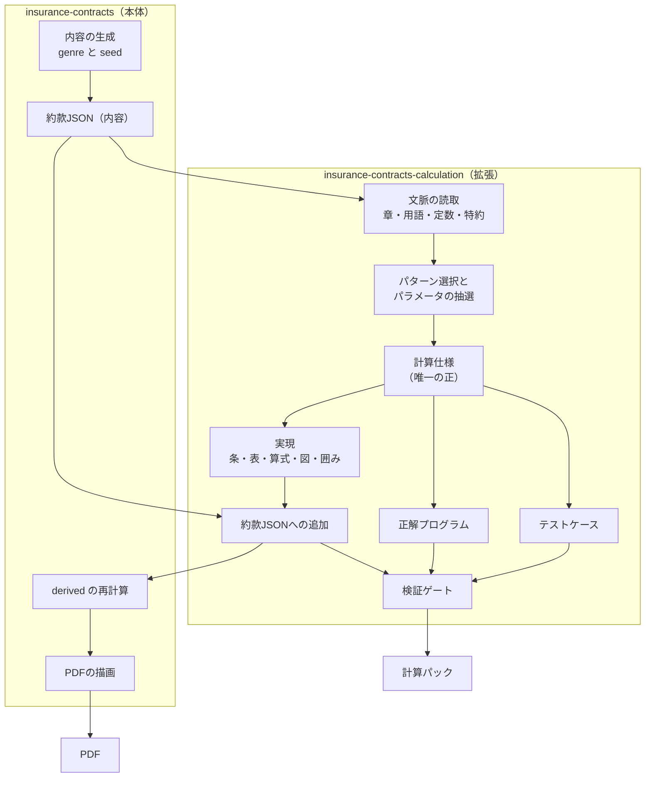

# insurance-contracts-calculation 設計書

約款合成データ生成 `insurance-contracts` の拡張機能。既定の約款JSONに、計算や判定を要する規定（条文・表・算式・図）を追加し、その正解プログラム（Python）とユニットテスト用の評価データを同時に生成する。

- 版: 0.2（2026-10-02 に 0.1 として起草。2026-10-05 に §6 を実物へ、§15 を `TASK.md` §2 への参照へ改訂）
- 配置: `insurance-contracts/insurance-contracts-calculation/`
- **本書は設計の正本である。実測の現況（文書数・ケース数・ゲートの結果）は `TASK.md` §2 を見る。**
  本書に数値を二重に持たせない（古い値が残るため）。

---

## 1. 要約

**計算仕様（CalcSpec）を唯一の正とし、そこから約款への追加・正解プログラム・テストを同時に生成する。** 文言と式を別々に作らないので、三者は構成上ずれない。さらに機械検査で一致を確かめてから出力する。

```
計算仕様 ──┬─▶ 約款JSONへの追加（条・項・表・算式・図・囲み・定数）──▶ 本体で derived 再計算・PDF化
（唯一の正） ├─▶ 正解プログラム（Python）
           ├─▶ テストケース（入力と期待値）＋ pytest
           └─▶ 正解表（どの単位がどのルールの根拠か）
```

これまでの検討（約款JSON → ルールIR → コード → テスト）の向きを逆にしたものである。前回作ったIR、検証器、コンパイラ、テスト生成は、ほぼそのまま生成側の部品になる（§14）。

試作で、自動車約款（auto-0001）に3条を追加し、次を確認した（§15）。

| 確認したこと | 結果 |
|---|---|
| 仕様と追加後の約款JSONの整合（根拠の逐語照合・単位・表の読取） | エラー 0 |
| 正解プログラムでのテスト（seed 1） | 104 件すべて合格 |
| 誤った実装（適用順の取り違え、「以上」の誤読）でのテスト | 14 件が不合格（見分けられる） |
| seed 1〜20 で生成 | 20 文書・2,126 ケースすべて合格、変異 960 件すべて検出 |
| 同じ seed での再生成 | 全ファイルのハッシュが一致 |

起草時に未確認だった `derived` の再計算とPDF化は、**実装で確認できた**（§17 の「確定した前提」）。
§17 の確認事項 7 件はすべて人が決定し、実装済みである。上の表は起草時の試作の記録で、
いまの規模と検証結果は `TASK.md` §2 にある。

---

## 2. 目的と範囲

### 2.1 目的

1. **読取評価の強化。** 計算や判定を含む規定を約款に増やす。算式ブロック、率表、場合分けの表、判定フローチャート、期間の時間軸図が対象になる。
2. **計算発見・コード生成の評価。** 「約款から計算式・判定式を見つけ、実装し、テストする」システム（以下、評価対象システム）を採点するための正解データを作る。

### 2.2 作るもの

| 生成物 | 内容 | 利用者 |
|---|---|---|
| 追加後の約款JSON | 既定の約款JSONに計算・判定の規定を足したもの | 本体（PDF化）、読取評価、評価対象システム |
| 計算仕様 | 式、入力、定数、表、根拠の対応 | 生成器自身、分析 |
| 正解プログラム | 仕様から生成した Python 関数 | 評価の基準 |
| 評価データ | テストケース（JSONL）と pytest | 評価対象システムの採点 |
| タスクカード | 関数名と入出力の契約 | 評価対象システムへの出題 |
| 正解表 | ルールと根拠単位の対応、表現手段、難易度 | 「発見」の採点、弱点分析 |

### 2.3 範囲外

- 評価対象システム自体（発見・翻訳・実装の仕組み）。
- PDFの描画と `derived` の計算。本体の機能を呼ぶ。
- SQLの正解プログラム。前回のコンパイラを任意の出力先として残すが、必須にしない。

---

## 3. 前提と用語

### 3.1 本体（`insurance-contracts`）についての前提

添付の3サンプル（`schema_version: "1.0"`）から読み取った内容に基づく。本体のコードは見ていないので、★は確認が必要な前提である。

- 約款JSONは、内容（`meta` `front_matter` `defined_terms` `body` `appendices` `back_matter`）と、内容から計算される索引（`derived`）からなる。
- 本文は木構造で、ノード種別は `part` `chapter` `section` `article` `paragraph` `item` `rider` `appendix` `appendix_section`。
- ブロック種別は `paragraph` `table` `formula` `figure` `box` `footnotes` `list`。
- 表は `semantic_type` を持つ（`rate` `grade_schedule` `benefit_schedule` `surgery_schedule` `exclusions` `enumeration` `procedure` `definitions` `generic` ほか）。
- 算式は `terms` に `box` `op` `fraction` を並べる（`layout: "inline_boxes"`）。
- 図は `diagram.kind` を持つ。サンプルにあるのは `flowchart` `timeline` `steps` `tree` `matrix` `annotated_mock`。
- 本文中の参照は `{const:キー}` `{term:ID}` `{ref:ID}` `{fn:n}` で書き、数値は `meta.constants` に持つ。
- ★ 本体は、内容から `derived` を再計算する処理と、約款JSONからPDFを描画する処理を、関数またはコマンドとして呼び出せる。
- ★ 読取評価は、読取結果を約款JSONの内容と照合する。`meta.constants` のキー名やノードIDは照合の対象外、または対応づけの手がかりに留まる。

### 3.2 用語

| 用語 | 意味 |
|---|---|
| 本体 | `insurance-contracts`。約款JSONとPDFを生成する既存プログラム |
| 計算仕様（CalcSpec） | 1文書に足す計算・判定ルールの定義。式の木、入力、定数、表、根拠を持つ |
| パターン | ルールの型（例：免責金額→限度額）。乱数からルール1件分の仕様を作る |
| 実現 | 仕様を約款の文言・表・算式・図に展開すること |
| 単位 | 約款JSONの中で根拠として指せる最小のテキスト（項、表のセル、脚注、図のノードなど） |
| 計算パック | 1文書分の生成物一式（仕様、正解プログラム、テスト、正解表、マニフェスト） |
| 評価対象システム | 約款から計算式・判定式を発見し、コードを生成するシステム |

---

## 4. 設計方針

1. **仕様が唯一の正。** 約款の文言、正解プログラム、テストの期待値は、すべて計算仕様から導く。人やLLMが文言とプログラムを別々に書く経路を作らない。
2. **本体のスキーマの範囲で足す。** 第1版は、既存のノード種別・ブロック種別だけを使う。本体の描画側を変えずに済む。
3. **決定的に生成する。** 同じ既定の約款、同じ seed、同じ生成器の版からは、同じバイト列を出力する。
4. **手がかりを漏らさない。** 追加したノードのIDや定数名に、拡張由来と分かる目印を付けない。正解は約款JSONに入れず、別ファイルに置く。
5. **一義に読めるように書く。** 適用順、端数処理、境界（以上・超える）、期間の数え方を、必ず文言にする（§8.3）。あえて欠落や矛盾を入れる場合は、ラベルを付けて別モードにする（§9.3）。
6. **検証してから出力する。** 検証ゲート（§12）をすべて通った文書だけを書き出す。
7. **検証器を共用する。** AIが抽出したIRを検査する検証器と、生成器の出力を検査する検証器は同じものを使う。評価対象システムに求める基準を、まず正解データ自身が満たす。
8. **本体への依存は1箇所。** 本体を呼ぶのは `base_adapter` だけにする。

### 4.1 採用しなかった方式

| 方式 | 採用しない理由 |
|---|---|
| 文言を先に書き、プログラムを後から人が書く | 一致の保証がなく、量産できない |
| LLMに文言とプログラムを同時に書かせる | 多様だが、正しさを保証できない。全件の人手確認が要る |
| 仕様から決定的に生成する（採用） | 文言の自然さと多様性に限界がある。文型の変種、配置の分散、図表化で補う（§8）。LLMによる言い換えは、検証つきで将来の拡張とする（§8.6） |

---

## 5. 全体像



処理の順序は次のとおり。

1. 本体が約款JSON（内容）を作る。
2. 拡張が文脈を読む。種目、章立て、定義語、既存の定数、付いている特約を調べる。
3. 文脈に合うパターンを選び、seed からパラメータを抽選して計算仕様を作る。
4. 仕様を実現する。条・項・表・算式・図・囲みを本体のスキーマで組み立て、追加操作（パッチ）として記録する。
5. パッチを約款JSONに適用し、本体で `derived` を再計算する。
6. 仕様から正解プログラムとテストケースを生成する。
7. 検証ゲートを通す。通らない文書は出力しない。
8. 本体でPDFを描画し、計算パックを書き出す。

---

## 6. ディレクトリ構成

実物である（2026-10-05 に起草時の案から差し替えた）。生成物（`out/`・`dataset/`）は git 無視。

```
insurance-contracts/
└── insurance-contracts-calculation/
    ├── README.md                        # 利用者向けの入口
    ├── CLAUDE.md                        # 守る規律（Claude Code が読む）
    ├── DESIGN.md                        # 本書（設計の正本）
    ├── TASK.md                          # 計画・残作業・実測の現況（§2）
    ├── HITL.md                          # 人間の意思決定の依頼と記録
    ├── PROMPT.md                        # セッション用プロンプト集
    ├── Makefile                         # check / test / lint / gen / verify / datacard / examples
    ├── pyproject.toml                   # ruff と pytest の設定（依存は本体の venv を使う）
    ├── docs/                            # 実測の記録（図の上限・G12・本体の不具合・データカードの仕様）
    ├── scripts/                         # check_base.py（本体の並行変更の検出）・verify_datacard.py
    ├── src/insurance_contracts_calculation/
    │   ├── cli.py                       # icc generate / batch / verify / eval / lint-base / export / package / datacard
    │   ├── generate.py                  # 1 文書の生成（GENERATOR_VERSION・doc_suffix）
    │   ├── batch.py                     # 複数文書の一括生成（失敗を黙って外さず記録する）
    │   ├── config.py                    # 生成設定（プロファイル、難易度、件数）
    │   ├── base_adapter.py              # 本体を呼ぶ唯一の場所（内容の取得、derived、PDF、lint、verify）
    │   ├── core/
    │   │   ├── docindex.py              # 約款JSONの索引（単位、参照、定数、{ref:}・{fn:} の解決）
    │   │   ├── numbers_ja.py            # 数値の表記（5万円、1,000円、60か月）
    │   │   └── packs.py                 # packs/*.yaml の読み込み
    │   ├── spec/                        # 計算仕様 CalcSpec v0.2（§10.1）
    │   │   ├── ops.py                   # 演算の台帳（意味論・型検査・生成・テスト・逆翻訳の共通の正）
    │   │   ├── validate.py              # 型・単位・根拠・明示性の検査（表のセルを読む _parse_cell）
    │   │   ├── obligations.py           # 明示性の要件（§8.3）
    │   │   └── interp.py                # 参照インタプリタ（意味論の正本）
    │   ├── patterns/                    # パターンライブラリ（§7）
    │   │   ├── base.py                  # Pattern の基底クラスと RuleDraft
    │   │   ├── registry.py              # 登録簿（IDの小さい順。選択の決定性のため）
    │   │   └── p01_limit.py … p18_waiting.py
    │   ├── planning/
    │   │   ├── context.py               # 既定の約款から文脈を読む
    │   │   ├── selector.py              # パターンの選択と衝突回避（ルールごとに独立した乱数）
    │   │   ├── placement.py             # 追加する場所の決定と前付けの索引への反映（§8.5）
    │   │   ├── presentation.py          # 表現手段と文型の割当（§8.4）
    │   │   └── challenge.py             # ラベル付きの難所（§9.3）
    │   ├── realize/
    │   │   ├── discourse.py             # 式の木 → 名前つきの手順（文・行・ノードの計画）
    │   │   ├── lexicon_ja.py            # 演算ごとの文型（日本語の文はここだけが持つ）
    │   │   ├── blocks.py                # 本体スキーマのノード・ブロックの組立
    │   │   ├── figures.py               # フローチャート、時間軸、判定マトリクス、ツリー、手順
    │   │   ├── examples.py              # 設例の囲み（§8.7）
    │   │   ├── explain.py               # 仕様 → 日本語の逆翻訳（レビュー用）
    │   │   └── patch.py                 # 追加操作の適用、ID・定数・用語の払出し
    │   ├── codegen/
    │   │   ├── python.py                # 正解プログラムの生成
    │   │   └── sql.py                   # 範囲外（出力しない。§3.3）
    │   ├── testgen/
    │   │   ├── cases.py                 # 境界値・日付の境界・不明値・乱数・設例
    │   │   ├── mutation.py              # テストの十分性の測定（G7）
    │   │   ├── taskcards.py             # 入出力契約とヒント 3 水準（CONVENTIONS が唯一の正）
    │   │   └── pytest_writer.py         # pytest の書き出し（--impl で実装を差し替える）
    │   ├── verify/
    │   │   ├── gates.py                 # 検証ゲート G1〜G11（GATE_TITLES が題の唯一の正。§12）
    │   │   ├── recheck.py               # 出力済みの文書にゲートだけ再実行する（icc verify）
    │   │   ├── discoverability.py       # 候補検出による発見可能性（G10）
    │   │   ├── solvability.py           # G12 解答可能性（出題の組立。docs/solvability_run.md）
    │   │   └── lint_base.py             # 既定の約款の計算規定の一覧（icc lint-base）
    │   ├── evalkit/
    │   │   ├── runner.py                # 提出プログラムの隔離実行
    │   │   ├── discovery.py             # 「発見」の採点
    │   │   ├── reading.py               # 読取結果との突き合わせ（--track e2e）
    │   │   └── report.py                # 軸ごとの集計レポート
    │   └── export/
    │       ├── layout.py                # 出力の配置、マニフェスト、ハッシュ、出力先の判定
    │       ├── datasheet.py             # データセットの説明書と公開パッケージ（icc export）
    │       ├── distribution.py          # 配布パッケージの組み立て（icc package。配布は人が行う）
    │       ├── huggingface.py           # Hugging Face 用のリポジトリ（icc package --format hf。H11）
    │       └── datacard.py              # data-card.md（実ファイルを測る。docs/data_card.md）
    ├── packs/                           # 種目ごとのパラメータ範囲と語彙（YAML）
    │   ├── auto.yaml golf.yaml group.yaml health.yaml
    │   ├── life.yaml oneday.yaml quake.yaml travel.yaml
    │   └── concepts.yaml                # 入力概念の語彙（名前、日本語名、型、単位）
    ├── tests/                           # 生成器自身のテスト（unit / integration）
    ├── examples/                        # 回帰の基準（seed 4）と wrong_impl.py。描画結果は入れない
    ├── out/                             # 生成物の既定の出力先（git 無視）
    └── dataset/                         # 生成物（git 無視。data-card.md と _run_report.json を含む）
```

---

## 7. パターンライブラリ

パターンは、ルールの型である。1つのパターンが、同じ乱数から「約款に足す内容」と「仕様」の両方を作る。

### 7.1 カタログ

サンプル3約款に現れた計算・判定の型をもとにした。優先度Aから実装する。

| ID | 型 | 式の形 | 主な表現手段 | 優先度 |
|---|---|---|---|---|
| P01 | 実費と限度額 | `min(x, L)` | 文、保険金一覧の表 | A |
| P02 | 免責金額と限度額 | `min(max(0, x − D), L)`。順序違いの変種あり | 文、算式、囲み | A（試作済） |
| P03 | 日額×日数 | `r × min(max(0, d − w), M)`。待機と上限 | 文、時間軸図 | A（試作済） |
| P04 | 等級表の割合×金額 | `A × 割合(等級) ÷ 100` | 別表（一致で引く） | A |
| P05 | 階段表の率×金額＋端数処理 | `floor(A × 率(月数) ÷ 100 ÷ u) × u` | 表（階段で引く）、文 | A（試作済） |
| P06 | 按分 | `X × a ÷ b` | 算式（分数）、文 | A |
| P07 | 場合分け | `if 条件 then A else B`（2〜3分岐） | 文、場合分けの表 | A |
| P08 | 内枠・別枠の限度 | `min(a + min(b, Ls), L)` または `min(a, L) + min(b, Ls)` | 文（内枠か別枠かを明示） | B |
| P09 | 明細の集計 | `min(Σ min(損害ᵢ, 限度(種類ᵢ)) − D, L)` | 付表、文 | B |
| P10 | 期限・期間 | `日付 + N日`。初日算入、翌日起算、月末 | 文、時間軸図 | B |
| P11 | 回数・期間の計算 | `max(満了月 − 発生月, 保証回数)` | 文、時間軸図、設例 | B |
| P12 | 判定（原則と除外） | `条件 ∧ ¬(除外1 ∨ 除外2 ∨ …)` | 文、号の表 | A |
| P13 | 上書き | 特約や証券の記載による定数・条件の差し替え | 特約の条、文 | B |
| P14 | フローチャート判定 | 図だけに書かれた判定の連鎖 | 図（flowchart） | A（試作済） |
| P15 | 合成 | 複数項目の合計、控除、限度 | 項目の表、文 | B |
| P16 | 通算限度 | `min(x, 通算限度 − 既払額)` | 文 | C |
| P17 | 逓減・逓増 | 経過年数に応じた割合 | 表、時間軸図 | C |
| P18 | 待機・不担保期間の判定 | 日付の比較による支払可否 | 文、時間軸図 | C |

### 7.2 パターンのインターフェース

```python
class Pattern(Protocol):
    id: str  # "P02"
    genres: set[str]  # 適用できる種目

    def applicable(self, ctx: Context) -> bool:
        """既定の約款に必要な章・用語・特約があり、既存の規定と衝突しないか。"""

    def sample(self, ctx: Context, rng: Random) -> RuleDraft:
        """パラメータを抽選し、仕様の下書き（式・入力・定数・明示すべき事項）を返す。"""
```

`RuleDraft` は表現に依存しない。文言と図表への展開は実現（§8）が受け持つ。試作では、簡単のためパターンが文言まで作っている。

### 7.3 文脈と衝突回避

`Context` は、既定の約款から次を読み取る。

- 種目（`genre`）、章立て、条の一覧
- 定義語（`defined_terms`）と、既存の定数（`meta.constants`）
- 付いている特約
- 既存の保険金の名称（保険金一覧の表から）

衝突回避の規則は次のとおり。

- 定数名と保険金の名称は、既定の約款にないものを使う。衝突したら生成を止める。
- 既存の規定と関係するパターンは、その規定の存在を `applicable` で確かめる。試作の「代替交通費用」は、既定の約款に代替車両費用特約があることを前提に、重複して支払わない旨を図に入れた。
- 同じ概念に2つの限度額を与えない。既存の定数を使うときは `{const:}` で参照し、新しい数値を書かない。

### 7.4 パラメータの抽選

- 値は種目ごとの `packs/<genre>.yaml` に範囲を持つ。きりのよい値（1万円、15日など）から選ぶ。
- 制約を守る。例：免責金額 < 限度額、階段表は単調、待機日数 < 上限日数。
- 入力概念（修理費、協定保険価額など）は `packs/concepts.yaml` の語彙から選ぶ。同じ概念には、文書をまたいで同じ引数名を使う。

---

## 8. 実現：仕様を約款の文言・表・算式・図に展開する

### 8.1 手順の計画

式の木を、名前つきの手順に分ける。約款が「…の額（以下「基準額」といいます。）」のように中間の額に名前を付けて書くのと同じ形である。1つの手順が、1つの文、表の1行、図の1ノードのどれかになる。

```
修理費 − 免責金額            → 手順1（文＋算式）
min(手順1, 限度額)           → 手順2（文「この額が…を超えるときは…」）
max(0, 手順2)                → 手順3（次の項「前項の…が0円を下回るときは…」）
```

正解プログラムも同じ手順を変数にする。文と変数が1対1に対応する。

### 8.2 演算と文型

| 演算 | 文型の例 |
|---|---|
| 差引 | 「AからBを差し引いた額とします。」 |
| 限度 | 「この額がLを超えるときは、Lとします。」／「ただし、Lを限度とします。」 |
| 下限0 | 「…が0円を下回るときは、…は支払いません。」 |
| 乗算（日額） | 「日数にRを乗じて得た額とします。」 |
| 表引き | 「…に応じて下表に定める割合を乗じて得た額とします。」 |
| 端数処理 | 「U未満の端数があるときは、これを切り捨てます。」 |
| 切上げ（期間） | 「1か月未満の端日数があるときは、これを1か月として計算します。」 |
| 按分 | 「Xに、AのBに対する割合を乗じて得た額とします。」＋分数の算式 |
| 小さい方・大きい方 | 「AまたはBのいずれか低い額」／「いずれか高い額」 |
| 場合分け | 「…の場合はA、それ以外の場合はBとします。」／場合分けの表 |
| 比較 | 「N以上」「N以下」「Nを超える」「N未満」 |
| すべて・いずれか | 「次のすべてに該当」「次のいずれかに該当」＋号の表 |
| 期限 | 「…の日からその日を含めてN日以内」／「…の翌日から起算してN日以内」 |
| 既定値 | 「保険証券に記載がないときは、Vとします。」 |

各演算に2〜4個の文型の変種を持つ。変種はすべて同じ意味で、1つずつ単体テストを持つ。

### 8.3 明示性の要件

通常モードでは、次を必ず文言にする。前回のサンプル分析で、ここが書かれていないと解釈が割れることが分かっている。パターンが「明示すべき事項」を宣言し、検証ゲートG3が、対応する文が実際に出力されたかを確かめる。

| 構造 | 必ず書くこと |
|---|---|
| 免責金額と限度額の併用 | どちらを先に適用するか |
| 割り算、割合の乗算 | 端数処理の単位と方向 |
| しきい値 | 以上、以下、超える、未満のどれか |
| 期間、期限 | 起算日（初日を数えるか）と満了の扱い |
| 差引の結果 | 0円を下回るときの扱い |
| 表引き | 表にないキーの扱い |
| 複数該当 | 高い方、合算、先に該当した方のどれか |
| 適用範囲 | 1事故、1名、1日、保険期間通算のどれか |
| 既定値 | 証券に記載がないときの値 |
| 内枠と別枠 | 小さい限度額が大きい限度額に含まれるか |

### 8.4 表現手段の割当

同じルールを、次のどれで表すかを seed から決める。難易度の主な軸になる（§9）。

| 表現手段 | 本体のブロック | 向くもの |
|---|---|---|
| 文 | `paragraph`、`item` | すべて |
| 算式 | `formula`（`box` `op` `fraction`） | 加減乗除の1行。限度や場合分けは文に残す |
| 参照表 | `table`（`rate` `grade_schedule` など） | 表引き |
| 場合分けの表 | `table`（`benefit_schedule` `generic`） | 場合ごとの額 |
| 号の表 | `table`（`exclusions` `enumeration`） | 条件の列挙 |
| フローチャート | `figure`（`flowchart`） | 判定の連鎖、どの算式を使うかの分岐 |
| 時間軸 | `figure`（`timeline`） | 待機期間、支払期間、期限 |
| 判定マトリクス | `figure`（`matrix`） | 条件と結果の対応 |
| 設例 | `box`（`margin_note`） | 説明。規範ではない（§8.7） |
| 脚注 | `footnotes` | 定義の補足、例外の細目 |

図と本文の役割は3通りある。

- **図だけが規範。** 本文は「下図の手順により判定します」とだけ書く。図を読めないと実装できない。
- **本文が規範で、図は説明。** 図は照合とテスト例に使える。
- **本文と図で分担。** 判定は図、金額は本文、のように両方が要る。

図の `alt` と `facts` は、図の構造から機械的に作る。図と食い違わない。

### 8.5 配置

| 配置 | 内容 | 難しさ |
|---|---|---|
| 条の追加 | 関連する章の末尾に条を足す | 低 |
| 別表への分離 | 率表や限度額の表を別表・付表に置き、本文から参照する | 中 |
| 特約 | 特約として足し、普通約款の定数や条件を上書きする | 中 |
| 分散 | 1つのルールの手順を、別の条、脚注、用語定義に分ける | 高 |
| 既存の条への追記 | 既存の条に項や表を足す | 高。既定の文言と整合する場合だけ |

ノードのID、ブロックのID、定数名は、本体の命名規則に従う（例：`ch3_a6`、`tbl_ch3_a7_rate`、`glass_limit`）。目次、目的別もくじ、特約一覧への行の追加が要る場合は、パッチに含める。

### 8.6 言い換え

第1版は文型テンプレートだけを使う。LLMによる言い換えを足す場合は、次をすべて通ったものだけを採用する。

1. 数値、定数の参照、定義語が、言い換えの前後で一致する。
2. 言い換えた文から、基準となるシステムが実装したプログラムが、同じテストに合格する。
3. 抜き取りで人が確認する。

### 8.7 設例

囲みに書く設例は、仕様を参照インタプリタで計算した値から作る。設例の数値はテストケース（種別 `example`）にも入れる。説明側の記述なので、規範の根拠にはしない。正解表では `explanatory_units` に分けて記録する。

---

## 9. 難易度と多様性

### 9.1 難易度の軸

| 軸 | 値 | 例 |
|---|---|---|
| 表現手段 | 算式あり、文のみ、表、図のみ | 図だけに書かれた判定 |
| 分散度 | 根拠単位の数と距離 | 限度額が別表にある |
| 合成の深さ | 手順の数、他のルールへの依存 | 判定の結果で金額が決まる |
| 上書き | なし、特約、証券の記載 | 特約が限度額を変える |
| 境界の数 | しきい値と表キーの数 | 8段の階段表 |
| 時間 | なし、日数、月・年、営業日 | 月末をまたぐ期限 |
| 妨害要素 | 設例の数値、目安の表、似た名称の別の保険金 | 規範でない数値が近くにある |
| 不明値 | 三値の判定が要るか | 修理可否が不明でも全損と確定できる |

各ルールの難易度は、正解表にベクトルとして記録する。評価結果を軸ごとに集計できる。

### 9.2 プロファイル

設定ファイルで、軸ごとの出現割合を指定する。既定のプロファイルを3つ用意する。割合の具体値は運用で決める。

| プロファイル | ねらい |
|---|---|
| `basic` | 1つの条に閉じたルール。算式ブロックまたは表がある |
| `standard` | 文と表の組合せ、別表への分離、判定と金額の連鎖 |
| `hard` | 図のみ、分散、特約による上書き、月・年の計算 |

### 9.3 ラベル付きの難所（challenge モード）

通常モードは一義に読める文書だけを作る。challenge モードでは、あえて次を入れ、正解表にラベルを付ける。評価対象システムが「実装できない、確認が要る」と報告できるかを測る。

| 種別 | 入れ方 | 採点 |
|---|---|---|
| 欠落 | 明示性の要件を1つ外す（例：端数処理を書かない） | 指摘の有無。テストは、欠落に影響されないケースだけを使う |
| 矛盾 | 本文と表で違う値を書く | 指摘の有無。両方の読みで結果が同じケースだけをテストに使う |
| 異例 | 特約を付けると限度額が下がる、など | 指摘の有無 |

前回の分析で、既定の約款に同種の箇所が3件見つかっている（対物賠償の適用順、弁護士費用の内枠・別枠、受託物の限度額）。現在はラベルがない。扱いは §17 の確認事項とする。

---

## 10. データモデル

### 10.1 計算仕様（CalcSpec v0.2）

前回のルールIR（v0.1）に、名前つきの手順、関数名、表現の計画、難易度を足す。

```json
{
  "spec_version": "0.2",
  "document": {"content_id": "auto-0001", "genre": "auto", "calc_seed": 1},
  "params": {
    "glass_deductible": {"unit": "JPY", "from_const": "glass_deductible",
      "source": {"unit": "ch3_a6_p2", "quote": "修理に要した費用の額から1万円を差し引いた額とします。"}}
  },
  "tables": {
    "replacement_rate": {"from_block": "tbl_ch3_a7_rate", "shape": "header_keys",
      "key_parse": "upto_month", "value_parse": "percent", "mode": "step_le"}
  },
  "rules": [{
    "id": "glass.payout",
    "title": "ガラス修理費用保険金の額",
    "kind": "calculation",
    "scope": "per_accident",
    "interface": {"function": "glass_payout"},
    "inputs": {
      "repair_cost": {"type": "int", "unit": "JPY", "min": 0, "max": 600000,
                      "origin": "claim_fact", "desc": "修理に要した費用の額"}
    },
    "steps": [
      {"name": "after_deductible", "label": "免責金額を差し引いた額",
       "expr": {"op": "sub", "args": [{"var": "repair_cost"}, {"param": "glass_deductible"}]}},
      {"name": "capped", "label": "限度額を適用した額",
       "expr": {"op": "min", "args": [{"step": "after_deductible"}, {"param": "glass_limit"}]}},
      {"name": "glass_payout", "label": "ガラス修理費用保険金の額",
       "expr": {"op": "max", "args": [{"lit": 0}, {"step": "capped"}]}}
    ],
    "output": {"step": "glass_payout", "type": "int", "unit": "JPY"},
    "obligations": ["order:deductible_then_limit", "floor:zero"],
    "presentation": {"pattern": "P02", "placement": "article",
                     "modalities": {"after_deductible": ["prose", "formula"], "capped": ["prose"], "glass_payout": ["prose"]},
                     "examples": 2},
    "sources": [{"unit": "ch3_a6_p2", "quote": "…"}, {"unit": "fml_ch3_a6"}, {"unit": "ch3_a6_p3", "quote": "…"}],
    "properties": [{"type": "range", "min": 0, "max_param": "glass_limit"}],
    "examples": [{"oracle": "document", "inputs": {"repair_cost": 60000}, "expect": 50000}],
    "difficulty": {"modality": "prose+formula", "scatter": 3, "depth": 3, "figure_only": false}
  }]
}
```

v0.1 から変える点は次のとおり。

| 項目 | v0.1（前回） | v0.2 |
|---|---|---|
| 式 | 1つの式の木（`expr`） | 名前つきの手順（`steps`）。文と変数に1対1で対応 |
| 関数名 | ルールIDから機械的に作る | `interface.function` で指定。パターンと保険金名から安定して決まる |
| 型 | 整数、真偽、文字列。日付は通し日数 | `date` 型を足す。`add_days` `add_months` `days_between` `end_of_month` |
| 端数処理 | `muldiv` の丸め | `round_to(x, 単位, 方向)` を足す |
| 明示性 | なし | `obligations`。実現が対応する文を出したかを検査する |
| 表現 | なし | `presentation`。表現手段、配置、設例の数 |
| 難所 | `variants` | `trap`。種別、期待する報告、読みごとの式 |

演算の意味論は v0.1 を引き継ぐ。金額は整数の円、不明は `None`、真偽は三値、端数処理は必須指定である。

### 10.2 約款JSONへの追加（パッチ）

追加は操作の列として記録する。何を足したかを後から追える。

```json
[
  {"op": "add_constant", "key": "glass_deductible", "value": "1万円"},
  {"op": "add_constant", "key": "glass_limit", "value": "20万円"},
  {"op": "add_node", "parent": "ch3", "position": "last", "node": {"id": "ch3_a6", "kind": "article", "…": "…"}},
  {"op": "add_block", "owner": "ch3_a6_p2", "block": {"type": "formula", "id": "fml_ch3_a6", "…": "…"}}
]
```

| 操作 | 内容 |
|---|---|
| `add_constant` | `meta.constants` に定数を足す |
| `add_term` | `defined_terms` に定義語を足す |
| `add_node` | 条、項、号、特約、別表を足す |
| `add_block` | 既存または追加したノードに、表・算式・図・囲み・脚注を足す |
| `add_index_row` | 目的別もくじ、特約一覧に行を足す |

既存の文言を書き換える操作は持たない。パッチの適用後に、本体で `derived` を再計算する。

試作が生成した項（抜粋）は次のとおり。本体のスキーマと同じ形である。

```json
{
  "id": "ch3_a6_p2",
  "kind": "paragraph",
  "title": null,
  "text": "ガラス修理費用保険金の額は、修理に要した費用の額から{const:glass_deductible}を差し引いた額とします。この額が{const:glass_limit}を超えるときは、{const:glass_limit}とします。その算出は、次の算式によります。",
  "summary": null,
  "blocks": [{
    "type": "formula",
    "id": "fml_ch3_a6",
    "alt": "修理に要した費用の額から自己負担となる額を差し引いた額が、ガラス修理費用保険金の額となることを示す算式。",
    "layout": "inline_boxes",
    "terms": [{"box": "修理に要した費用の額"}, {"op": "－"}, {"box": "{const:glass_deductible}"},
              {"op": "＝"}, {"box": "ガラス修理費用保険金の額"}]
  }],
  "children": [], "badges": [], "kind_label": null, "number_override": null, "number_override_reason": null
}
```

### 10.3 出力の配置

```
<出力先>/<content_id>/
├── policy.json                      # 追加後の約款JSON（derived 再計算済み）
├── <content_id>--<レイアウト>.pdf    # 本体が描画
└── calc/
    ├── spec.json                    # 計算仕様
    ├── patch.json                   # 追加操作の記録
    ├── answer_key.json              # 正解表
    ├── tasks.jsonl                  # タスクカード
    ├── cases.jsonl                  # テストケース
    ├── programs/calc_<id>.py        # 正解プログラム
    ├── tests/conftest.py
    ├── tests/test_calc_<id>.py
    └── manifest.json                # 版、seed、ハッシュ、検証結果
```

追加後の文書は、既定の文書と区別できるIDにする（例：`auto-0001-c1`）。`policy.json` には、正解への参照や拡張の版を書かない。

データセット全体には、文書ごとの出力に加えて次の 2 つを置く。

| ファイル | 内容 | 書くもの |
|---|---|---|
| `_run_report.json` | 生成時の記録（何を作り、何を作れなかったか） | `icc batch` |
| `data-card.md` | **利用者向けのデータカード**（規模・内訳・正解の中身・検証の結果・制限と偏りの実測） | `icc datacard update`（`batch` と `generate` からも呼ぶ） |

カードの数値は**すべて出力の実ファイルから測る**。節と測り方の正本は `docs/data_card.md` で、
データを足したら `make check` が鮮度を検査する。

公開と非公開は、**別の 2 軸**で分ける。混同すると、評価の最中に正解を渡してしまう。

| 軸 | 何を決めるか | 決めるもの |
|---|---|---|
| **A 採点時に渡すか** | 評価対象システムに見せるファイル。`icc export` が機械的に分ける | 下の表。**変えない** |
| **B 配布するか** | データセットとして外部に置くファイル | `HITL.md` H4 で **(c) 正解も含めて配る**と決めた（2026-10-03） |

**軸 A（採点時に渡すか）** — 評価の健全性のための線で、B の決定では変わらない。

| ファイル | 評価対象システムに渡すか |
|---|---|
| `policy.json`、PDF | 渡す |
| `tasks.jsonl` | 渡す（ヒントの水準は §11.4） |
| `cases.jsonl`、`tests/` | 渡さない。設例（種別 `example`）だけ公開してよい |
| `spec.json`、`programs/`、`answer_key.json`、`patch.json` | 渡さない |

**軸 B（配布するか）** — 2026-10-03 の決定により、**正解を含めて**配る（`HITL.md` H4 (c)）。
**2026-10-05 に Hugging Face での公開が決まった**（`HITL.md` H11）。公開用リポジトリは
`icc package <dataset> --format hf --out <先>`（`export/huggingface.py`）が組む。
公開物は `spec.json`・`answer_key.json`・`programs/`・`cases.jsonl`・`tests/` を**含む**。
そのため次の 2 点を配布物に明記する義務が生じる。

1. **汚染（contamination）の注意。** 正解が公開されるので、学習データに入った時点でこのデータセットは
   そのモデルの評価に使えなくなる。`DATASHEET.md` に「学習に使わないこと」「汚染が疑われる場合の
   再生成手順（`specs/` と seed から作り直せる）」を書く。
2. **採点時の分離。** 利用者が自分で評価するときは `icc export` で軸 A の部分集合を作る、と書く。

**配布そのものは人の作業である。** AI は公開用リポジトリを**組むところまで**をやり、
push もアップロードもしない（`HITL.md` H4-b の後半は H11 でも効いている）。

Hugging Face の作法に合わせて足すものは 4 つある（`export/huggingface.py`）。

| 足すもの | なぜ要るか |
|---|---|
| データセットカード（`README.md` の YAML frontmatter） | 無いと HF がライセンスを `unknown` と表示し、言語・課題の索引にも載らない |
| 機械可読ビュー（`views/*.jsonl`）と `configs` | 文書ごとの入れ子の木は `load_dataset()` が読めない。**先頭の config が既定になるので、正解（`cases`）を先頭にしない** |
| LFS の設定（`.gitattributes`） | PDF と PNG を通常の git に入れると使えなくなる。JSON は 10MB 未満なので LFS に入れない（ビューアが読めなくなる） |
| フォントのライセンス（`licenses-fonts/`） | PDF に Noto（OFL 1.1）と IPAex（IPA v1.0）がサブセット埋め込みされている |

公開用リポジトリに**入れない**もの：`render.html`（生成の中間物。本体が配布対象外と定めている）と、
描画ごとの `source.json`（同じ文書の `policy.json` とバイト単位で同一の重複。
外す前に `huggingface.check()` が同一性を測る）。

### 10.4 正解表

```json
{
  "rule": "glass.payout",
  "function": "glass_payout",
  "pattern": "P02_deductible_then_limit",
  "units": ["ch3_a6_p2", "fml_ch3_a6", "ch3_a6_p3"],
  "explanatory_units": ["box_ch3_a6_note_p1"],
  "constants": ["glass_deductible", "glass_limit"],
  "modalities": ["prose", "formula", "box"],
  "difficulty": {"scatter": 3, "order_explicit": true, "floor_explicit": true, "figure_only": false}
}
```

`units` は規範の根拠、`explanatory_units` は説明（設例など）である。「発見」の採点は `units` に対して行う。

---

## 11. 正解プログラムと評価データ

### 11.1 正解プログラムの規約

- 1文書につき1モジュール（`calc_<content_id>.py`）。標準ライブラリだけを使う。
- 1ルールにつき1関数。引数はキーワード専用にする。
- 金額は整数の円。割合は整数演算で計算し、端数処理を式に書く。
- 入力が `None`（不明）で結果を確定できないときは、`None` を返す。真偽は三値で扱う。
- 日付は `datetime.date`。
- 定数は、根拠の条番号をコメントに付けてモジュールの先頭に置く。参照表はセルから読んだ値を持つ。
- 関数の説明文字列に、根拠の条番号と前提を書く。

試作が生成した関数（seed 1）は次のとおり。

```python
P_GLASS_DEDUCTIBLE = 10000  # 1万円 [JPY] 根拠: 第4章 第6条 (2)
P_GLASS_LIMIT = 200000  # 20万円 [JPY] 根拠: 第4章 第6条 (2)


def glass_payout(*, repair_cost=None):
    """ガラス修理費用保険金の額

    根拠: 第4章 第6条 (2); 第4章 第6条 (3)
    """
    t1 = None if (repair_cost is None) else repair_cost - P_GLASS_DEDUCTIBLE
    t2 = None if (t1 is None) else min(t1, P_GLASS_LIMIT)
    t3 = None if (t2 is None) else max(0, t2)
    return t3
```

試作は前回のコンパイラをそのまま使っているので、変数名が `t1` `t2` になり、同じ部分式を2回計算することがある。v0.2 では手順の名前を変数名にする。目標の書式は次のとおり（未実装）。

```python
def glass_payout(*, repair_cost: int | None = None) -> int | None:
    """ガラス修理費用保険金の額（第4章 第6条）"""
    if repair_cost is None:
        return None
    after_deductible = repair_cost - P_GLASS_DEDUCTIBLE  # 第6条(2) 第1文
    capped = min(after_deductible, P_GLASS_LIMIT)  # 第6条(2) 第2文
    return max(0, capped)  # 第6条(3)
```

### 11.2 タスクカード（入出力の契約）

評価対象システムのプログラムを同じテストで採点するには、関数名と引数を揃える必要がある。タスクカードで契約を渡す。

```json
{
  "task_id": "auto-0001:glass_payout",
  "content_id": "auto-0001",
  "function": "glass_payout",
  "title": "ガラス修理費用保険金の額",
  "kind": "calculation",
  "inputs": [{"name": "repair_cost", "type": "int", "unit": "JPY", "desc": "修理に要した費用の額",
              "origin": "claim_fact", "nullable": true}],
  "output": {"type": "int", "unit": "JPY", "nullable": true},
  "conventions": {"call": "キーワード引数で呼び出す", "money": "金額は整数（円）",
                  "unknown": "入力が None で結果を確定できないときは None を返す"}
}
```

### 11.3 テストケース

```json
{"case_id": "auto-0001:glass_payout:e001", "rule_id": "glass.payout", "function": "glass_payout",
 "kind": "example", "inputs": {"repair_cost": 60000}, "expected": 50000}
{"case_id": "auto-0001:glass_payout:b004", "rule_id": "glass.payout", "function": "glass_payout",
 "kind": "boundary", "inputs": {"repair_cost": 10000}, "expected": 0}
{"case_id": "auto-0001:glass_payout:u010", "rule_id": "glass.payout", "function": "glass_payout",
 "kind": "unknown", "inputs": {"repair_cost": null}, "expected": null}
```

| 種別 | 作り方 | ねらい |
|---|---|---|
| `example` | 約款の囲みに書いた設例 | 文書と仕様の一致。公開してよい |
| `boundary` | 入力と同じ単位を持つ定数・表キーの±1、入力どうしの±1 | 以上と超える、限度額、表の段の境目 |
| `unknown` | 入力を1つずつ `None` にする | 不明の伝播。採点から外せるよう種別を分ける |
| `random` | 宣言した値域からの乱数 | 全体の挙動 |

境界値は、仕様を1箇所だけ壊した変異をすべて検出できる組を選ぶ。境界値で検出できない変異が残ったら、乱数探索で検出できる入力を足す。試作では、端数処理の単位を1円ずらす変異が境界値だけでは検出できず、この探索で入力を補った。

期待値は参照インタプリタで計算する。正解プログラムの出力と一致しなければ、生成を止める。

### 11.4 pytest と採点

```
pytest calc/tests                        # 正解プログラムで実行
pytest calc/tests --impl my_module.py    # 評価対象のプログラムで実行
```

テストは `cases.jsonl` を読み、関数を名前で呼ぶ。評価対象のモジュールは `--impl` で差し替える。提出されたプログラムは、ネットワークなし・時間制限つきの別プロセスで実行する（`evalkit/runner.py`）。

評価の種類は次のとおり。

| 種類 | 入力 | 出力 | 採点 |
|---|---|---|---|
| 発見 | 約款JSON | ルールの一覧と根拠単位 | 正解表の `units` に対する再現率と適合率 |
| 実装 | 約款JSON＋タスクカード | Pythonモジュール | 関数ごとの合格（全ケース合格）、ケース単位の合格率 |
| 一気通貫 | PDF（読取結果のJSON）＋タスクカード | Pythonモジュール | 実装と同じ。読取の誤りの影響を含む |

タスクカードのヒントは3水準を用意する。

| 水準 | 渡すもの |
|---|---|
| H0 | 関数名と入出力だけ |
| H1 | H0＋主な条の条番号 |
| H2 | H1＋根拠単位のID |

結果は、パターン、表現手段、難易度の軸、テストの種別ごとに集計する。図のみのルールに弱い、境界に弱い、といった傾向を見られる。

---

## 12. 検証ゲート

すべて通った文書だけを出力する。

| ゲート | 検査 | 試作 |
|---|---|---|
| G1 仕様の検査 | スキーマ、型と単位、未宣言の入力、根拠のない数値 | 済 |
| G2 根拠の照合 | 仕様の引用が、追加後の約款JSONの単位に逐語で存在する | 済 |
| G3 明示性 | パターンが宣言した「明示すべき事項」に、対応する文がある | 未 |
| G4 数値の往復 | 定数の表記と表のセルを読み直した値が、仕様の値と一致する | 済 |
| G5 設例の一致 | 約款に書いた設例の数値が、参照インタプリタの結果と一致する | 済 |
| G6 実装の一致 | 参照インタプリタと正解プログラムが、全ケースで一致する | 済 |
| G7 テストの十分性 | 変異をすべて検出する。検出できない変異には理由を記録する | 済 |
| G8 衝突なし | 定数名、用語、保険金名が既定の約款と衝突しない。同じ概念に2つの値がない | 一部（定数名のみ） |
| G9 本体の検査 | スキーマ検証、`derived` の再計算、PDFの描画が成功する | 未（本体が必要） |
| G10 発見可能性 | 根拠単位が、決定的な候補検出で拾える。拾えない単位は記録する | 済（記録のみ） |
| G11 決定性 | 同じ seed で再生成し、ハッシュが一致する | 済 |
| G12 解答可能性（任意） | 基準となるシステムが、H2 のヒントで合格する。不合格のルールは人が確認する | 未 |

G12 は生成器の誤りを見つける最後の網である。文言が仕様と食い違っていれば、基準となるシステムが系統的に不合格になる。

---

## 13. コマンドと設定

```
icc generate --genre auto --seeds 1-100 --profile standard --out data/calc
icc generate --base path/to/auto-0001.json --seed 1 --out data/calc     # 既定の約款JSONを直接指定
icc verify   data/calc/auto-0001-c1                                     # 検証ゲートだけを再実行
icc eval     --submission subs/system_a --data data/calc --track impl --hint H1
icc lint-base path/to/auto-0001.json                                    # 既定の約款の計算規定を点検
icc datacard update data/calc                                           # データカードを書き出す（§10.3）
icc datacard check  data/calc                                           # カードが現在の出力と合っているか
```

設定ファイルの例。

```yaml
profile: standard
rules_per_document: {min: 3, max: 6}
patterns:
  include: [P01, P02, P03, P04, P05, P07, P12, P14]
modalities:              # 出現の重み
  prose: 3
  formula: 2
  table: 2
  figure_only: 1
placement:
  article: 3
  appendix: 1
  rider: 1
cases:
  random_per_rule: 12
  unknown: true
challenge:
  enabled: false
```

seed は、既定の文書のID、拡張の seed、生成器の版から導く。乱数は文書ごと・ルールごとに独立させる。パターンを足しても、既存の文書の出力が変わらないようにするためである。

---

## 14. これまでの実装の再利用

前回の検証コード（`yakkan_rules`）は、向きを逆にして使える。

| 前回のモジュール | 新しい位置 | 変更点 |
|---|---|---|
| `docindex.py`（索引、数値の正規化） | `core/docindex.py` | 図のノード・辺のラベルを単位として索引化（試作で対応済） |
| `ir.py`（IRの読込と静的検証） | `spec/validate.py` | v0.2 の手順、日付型、明示性の検査を足す |
| `interp.py`（参照インタプリタ） | `spec/interp.py` | 日付の演算を足す |
| `compile_py.py`（Python生成） | `codegen/python.py` | 手順の名前を変数名にする。型ヒントを付ける |
| `compile_sql.py`（SQL生成） | `codegen/sql.py` | 任意の出力先として残す |
| `testgen.py`（境界値、変異） | `testgen/` | 変異を検出する入力の選択と探索（試作で対応済）。日付の境界 |
| `candidates.py`（候補検出） | `verify/discoverability.py` | 発見可能性の検査と、「発見」評価の基準線に使う |
| `explain.py`（日本語への逆翻訳） | `realize/explain.py` | 実現した文と仕様の照合に使う |
| `rule_ir.schema.json` | **作らなかった** | 検査は `spec/validate.py` のコードが持つ（JSON Schema は二重管理になるため置かない） |
| 欠陥注入のテスト | `tests/` | 生成器自身のテストにする |

前回の分析結果も設計に使っている。

| 前回の発見 | 設計への反映 |
|---|---|
| 計算の大半は算式ブロックの外にある | 文・表・図の表現手段を持たせる（§8.4） |
| 適用順や端数処理が書かれていないと解釈が割れる | 明示性の要件（§8.3） |
| 本文と表の食い違いが実際にある | 通常モードでは構成上起こさない。challenge モードでラベルを付けて入れる（§9.3） |
| 設例は独立した期待値になる | 囲みの設例を仕様から生成し、テストにも入れる（§8.7） |
| 数値の転記が誤りの元になる | 値は `meta.constants` と表のセルに1回だけ書き、仕様はそれを指す |
| 検出できない変異はテストの穴を示す | テストの十分性をゲートにする（G7） |

---

## 15. 実装の現況

設計の全体を実装した。**規模と検証結果の実測値は `TASK.md` §2 にある**（本書には置かない。
二重に持つと古い値が残る）。実装して分かった設計上の事実だけを §15.3 に残す。

### 15.1 規模

| 項目 | 内容 |
|---|---|
| パターン | 18 種（P01〜P18）。一括生成で 18 種すべてが使われる |
| 種目 | 8（auto・quake・health・oneday・travel・golf・group・life）。`teikan`・`jyusetsu` は対象外 |
| 配置 | 3 通り（条の追加・別表への分離・特約への分離）。但し書きの行き先はさらに 3 通り（次の項・条末脚注・**別の条**）。プロファイルの `scatter` が割合を決める |
| 文書数・ルール数・ケース数・ページ・難易度の分布 | **`TASK.md` §2.1 を見る**。データセット自体の素性は `dataset/data-card.md`（実ファイルを測った生成物） |
| 生成器自身のテスト件数 | **`TASK.md` §2.1 を見る**（`make check` と `make test-all` で回す） |

### 15.2 検証ゲートの実装

ゲートの題の唯一の正は `verify/gates.py` の `GATE_TITLES` である。

| ゲート | 状態 |
|---|---|
| G1 仕様の検査 / G2 根拠の照合 / G4 数値の往復 | 済（`RuleSet.validate()` の指摘を振り分ける） |
| G3 明示性 | 済。要件を 1 つ落とすと落ちることをテストで固定 |
| G5 設例の一致 | 済。**出力された囲みの文を読み直して**参照インタプリタの結果と突き合わせる |
| G6 実装の一致 / G7 テストの十分性 | 済。変異が残るときは 1 入力を densely 掃いて検出する入力を探す |
| G8 衝突なし | 済。定数名・用語・保険金名・ID に加え、**表記の部分一致**（本体 lint L11）まで見る |
| G9 本体の検査 | 済（a: lint、b: ページと分量の予算、c: `verify_dataset`） |
| G10 発見可能性 | 済（記録のみ。拾えない単位を manifest に残す） |
| G11 決定性 | 済（同じ seed で全ファイルのハッシュが一致することをテストで固定） |
| G12 解答可能性 | 済。基準システムは**セッション内サブエージェント**（`HITL.md` H5 (a) で人が承認）。生成の経路外なので §8.6 の禁止に当たらない。実測は `docs/solvability_run.md` |

### 15.3 実装して分かったこと

- **本体の `verify_dataset` は図の大きさを見ない。** 16 ノードのフローチャートでも指摘 0 件だった。
  上限は生成側で止める（`docs/figure_limits.md` に実測を残した）。
- **本体 lint L11（定数の直書き）は部分文字列で当たる。** 定数「5万円」に対して設例の「375万円」が当たる。
  新しい定数の値も、既定の約款の地の文に現れる表記は避ける。
- **届かない限度額は規定として空振りする。** 明細の集計で「上限まで積んでも届かない限度額」を置くと、
  取り違えても結果が変わらず、G7 の変異が残る。値域の抽選で到達可能性を制約する。
- **分量の上限は最終形で測る。** 設例の囲みを入れると字数が増えるので、
  1 パス目だけで測ると本体 lint L09 に当たることがある。
- **別表のIDは blueprint が予約している。** `app1` などで作ると「その別表の中に◯行以上の表が要る」
  という必須要素（本体 lint L04 の `under`）に当たる。予約IDを避けて払い出す。
- **特約は既存の特約と同じ親に置く。** `auto` は `body` 直下、`life` は `part`（特約条項）の下にある。
- **分散の割合を二重に割り引かない。** 脚注への割り振りを `scatter × 0.5` にしていたため、
  `standard`（0.3）では 141 ルール中 2 件しか出なかった。配置と脚注は独立な軸なので、
  どちらも `scatter` そのもので決める。
- **分散はルール群単位で決める。** 先頭のルールだけを見ていたため、判定のルールが先頭に来る群は
  脚注に割られなかった。群のどれか 1 つが但し書きを持てば割る。
- **パターンの出現数は宿主（そのパターンを挙げている題材）の数にほぼ比例する。** 宿主 1〜2 件の
  パターンは一括生成に出てこない。宿主を増やし、題材が複数挙げるときのくじを希少さで
  重みづけして 18/18 にした。**並び順まで重みづけすると、ルール数の上限で切る組み直しのたびに
  文書の中身が総入れ替えになる**ので、そこには手を入れない（回帰の基準が壊れる）。
- **検証に通った集合は「通りやすい組」に偏る。** 落ちた文書はバッチが seed をずらして組み直すので、
  特定の経路だけが黙って消える。v1.2 で脚注の分散が 4/144 しか出なかったのはこれで、
  真の原因は下の `{fn:}`・`{ref:}` の解決の誤りだった。**「出力に出てこない」は「作っていない」ではなく
  「落ちて組み直された」かもしれない**と疑う。
- **プレースホルダの表示文字列を自分で組まない。** `{fn:n}` は `digit_style`・`numbering_scheme`・
  `footnote_style` で変わり（`（*1）`／`（*１）`／`（注1）`／❶）、`{ref:}` は引用元から見た相対表記に
  条の見出し文言が付く（`labels[..].citation` の「第4章 第7条」ではなく「第7条（買替費用保険金）」）。
  `{fn:}` は `meta` から規則を組み、`{ref:}` は**本体が `derived.refs` に残した描画結果**を引く。
  決め打ちすると根拠の引用が原文と食い違い、G2 が落ちる。
- **本体 `lint` の条キャッシュは `id(draft)` をキーにしていて消されない。** 同じ番地が再利用されると
  別の draft の脚注を見て、間欠的に誤った L02 を出す（`docs/base_lint_cache_note.md`）。

## 16. 実装計画

期間は置かず、段階と完了条件で示す。

| 段階 | 内容 | 完了条件 |
|---|---|---|
| 1 本体との接続 | `base_adapter` を実装する。パッチ適用後に `derived` を再計算し、PDFを描画する | 試作の3条を含む `auto-0001` のPDFが描画され、読取評価が従来どおり動く |
| 2 仕様 v0.2 と生成の骨格 | 手順、関数名、日付型、端数処理。パターンと実現を分ける。優先度Aのパターン | 3種目で各3〜6ルールを生成し、G1〜G11 を通る |
| 3 表現手段と配置 | 場合分けの表、号の表、時間軸、判定マトリクス。別表・特約・分散の配置 | 難易度の軸ごとに生成例があり、プロファイルで割合を制御できる |
| 4 評価キット | 隔離実行、発見の採点、集計レポート、データセットの説明書 | 基準となるシステムの提出を採点し、軸ごとの結果が出る |
| 5 優先度B・Cのパターン、challenge モード | 上書き、明細の集計、通算限度、ラベル付きの欠落・矛盾 | challenge の文書で、指摘の有無を採点できる |
| 6 言い換え（任意） | 検証つきのLLM言い換え | §8.6 の3条件を通った文だけが採用される |

段階 1〜5 は実装済み。段階 6（言い換え）は未着手で、v1 の範囲外とする（文型の変種と
表現手段の割当で多様性を作る）。

---

## 17. 確認事項

**2026-10-03 に 7 件すべて人が決めた。** 判断に要る実測・選べる案・決定の理由は `HITL.md` にある。
**7 件すべて 2026-10-04 に実装した。** 反映状況は `HITL.md` §2、残作業は `TASK.md` §3。

| # | 確認事項 | 決定（2026-10-03） | 実装 |
|---|---|---|---|
| 8 | 既定の約款に既にある計算規定（解釈が割れる箇所）の扱い | **既定分も一義に書き直す**（`HITL.md` H1 (b)）。対象は `icc lint-base` が挙げた **109 件／53 文書**（当初 729 件と見ていたが、検出器の誤検出を 3 度に分けて除いた実測）。**直し終えて `ambiguous` は 0 件** | 済（S10-4） |
| 9 | 不明値（`None`）を採点に含めるか | **含める**（種別 `unknown` で切り離せる形を維持。`HITL.md` H2 (a)）。変更なし | 済 |
| 10 | データセット全体の規模の上限 | **スタイルを増やして同じ content を複数描画する**（`HITL.md` H3 (c)）。文書数は増やさない | 済（S10-5） |
| 11 | 公開範囲と配布の可否 | **正解も含めて配る**（`HITL.md` H4 (c)）。採点時に渡す線（§10.3 軸 A）は変えない。**配布作業は人** | **済**（S10-6＋S14）。**2026-10-05 に Hugging Face 公開が決まり**（H11）、公開用リポジトリを組む `--format hf` を実装した。アップロードは人 |
| 12 | G12 の基準システム | **セッション内のサブエージェントにする**（`HITL.md` H5 (a)）。生成の経路外なので §8.6 の禁止には当たらない | 済（S10-3） |
| 13 | 本体 `yakkan` に見つけた不具合 2 件 | **両方直す**（`HITL.md` H6 (c)）。lint のキャッシュと脚注の段割れ。既存 104 データセットの再描画が伴う（103 件が verify 通過） | 済（S10-1・S10-2） |
| 14 | 基準の文書とずれた `examples/wrong_impl.py` | **現状維持**（`HITL.md` H7 (a)）。30 件が `TypeError` になることを D3 に明記したまま置く。書き直さない | 済 |

実装で確定し、この表から落とした項目は次のとおりである。

| 確定した前提 | 結果 |
|---|---|
| `derived` の再計算とPDF描画を外から呼べるか | 呼べる。`yakkan.build.build` / `yakkan.render.weasy.render_source` / `yakkan.verify.checks.verify_dataset` |
| 読取評価が定数キー・ノードIDを照合に使うか | 使わない（突合は中身で行う）。採点も関数名で対応づける |
| 算式ブロックの表現範囲 | 括弧なし・複数行なし・演算子は `＋－×÷＝` の 5 種のみ |
| 図の必須項目と大きさの上限 | 下限は本体 lint L06（flowchart 5 ノード・timeline 4 要素・matrix 4×3）。上限は実測（`docs/figure_limits.md`） |
| 種目の一覧と命名 | 10 種目のうち 8 種目を対象にする。`teikan`・`jyusetsu` は対象外（計算規定が無い／条を持たない）。`life` は v1.1 で入れた（ページ余裕が足りない 2 文書だけ外す） |
| 条を足したとき目次・索引は自動更新されるか | 目次は自動。目的別もくじは手書きの表なので `add_index_row` が要る（実装済み） |
| 追加後の文書IDの付け方 | `<既定のID>-c1`。同じ既定の約款から作る 2 本目以降は `-c2`・`-c3`（`--variant`。2026-10-04 に追加）。番号は乱数に入れず、`batch` が種を 1000 ずつずらして別の規定にし、先の本と同じ顔ぶれなら組み直す。出力先は**本体の** `dataset/` の外（拡張自身の `out/` と `dataset/` はどちらでもよい。同日に `check_out_dir` の判定をディレクトリ名の一致から本体のパスの一致に直した） |
| 1 文書あたりのルール数 | プロファイルで 3〜6。ページと分量の予算に収まるまで減らす |
